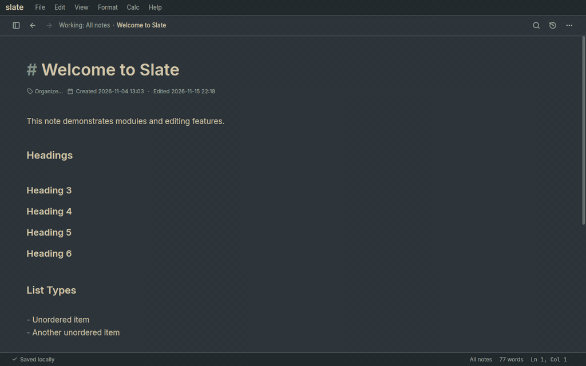

# AI: ask an agent, connect assistants

Slate works with AI in two directions, both off until you turn them on:

- **`:ask`** sends a question about your note to an AI agent (Claude Code,
  Codex, or your own command) and lets you put the answer into the note.
- **The MCP server** (`slate mcp`) lets AI assistants such as Claude Code,
  Codex or opencode search, read and edit your notes.

Slate itself has no AI model, account or API key. It uses the agent CLI you
already have installed and signed in to.

## Ask an agent about your note



### Setup

1. Install [Claude Code](https://code.claude.com/docs/en/setup) or
   [Codex CLI](https://github.com/openai/codex) and sign in once from a
   terminal (`claude`, or `codex login`).
2. Add this to `~/.config/slate/config.toml`:

   ```toml
   [agent]
   enabled = true
   preset = "claude"     # or "codex", or "custom" with argv = [...]
   context = "note"      # what goes with your question: "selection", "note" or "none"
   notes = "read"        # what the agent may do with other notes: "write", "read" or "none"

   [mcp]
   enabled = true        # needed for the agent to reach other notes
   ```

The settings are read on every request, so there is nothing to restart.

### Using it

- `:ask Which cost dominates this budget?` sends the question with the note
  (or the selection) and shows the answer when it is ready. Agents usually
  take 10 to 60 seconds; you can draft your next question meanwhile.
- **Insert latest** puts the answer into the note at the cursor (terminal:
  `Enter`); **Copy latest** copies it.
- Ask a follow-up in the same box: the conversation continues, across notes,
  until you type `/clear` or quit.
- `Esc` cancels a running request or closes the box.

With `notes = "read"` the agent can also look things up in your other notes
("compare this with last month's budget"); with `notes = "write"` it can
change them too, never delete. Edits it makes to the open note arrive as one
step you can undo.

**What leaves your computer:** your question, the note or selection (per
`context`), and whatever notes the agent reads go to the agent's model
provider. Encrypted notes are never sent: `:ask` is refused on them and the
agent can't open them.

Details and troubleshooting: [Ask the agent](reference/agent.md).

## Connect AI assistants (MCP)

[MCP](https://modelcontextprotocol.io) is the standard way AI assistants
reach outside tools. `slate mcp` serves your notes to them, so you can tell
your assistant "add this to my meeting notes" or "what did I write about the
Lisbon trip?".

1. Turn it on in `~/.config/slate/config.toml`:

   ```toml
   [mcp]
   enabled = true
   allow_delete = false   # true also lets assistants delete notes for good
   ```

2. Connect your assistant:

   ```sh
   claude mcp add --scope user --transport stdio slate -- slate mcp   # Claude Code
   codex mcp add slate -- slate mcp                                    # Codex
   ```

   For opencode or any other client, configure a stdio server that runs
   `slate` with the argument `mcp`.

The assistant can list and search notes (with the same
[search language](search.md)), read them, create notes, append, replace
text, rename, manage collections and archive notes. Deleting is off unless
you allow it. Every change is checked against the version the assistant
read, so it can't overwrite edits you made meanwhile, and an open note picks
up the change within a second.

To limit a client, start its server with `slate mcp --read-only` (only list,
search and read) or `slate mcp --no-delete`. Encrypted notes stay closed to
every client.

Full tool list and client setup: [MCP server](reference/mcp.md).
