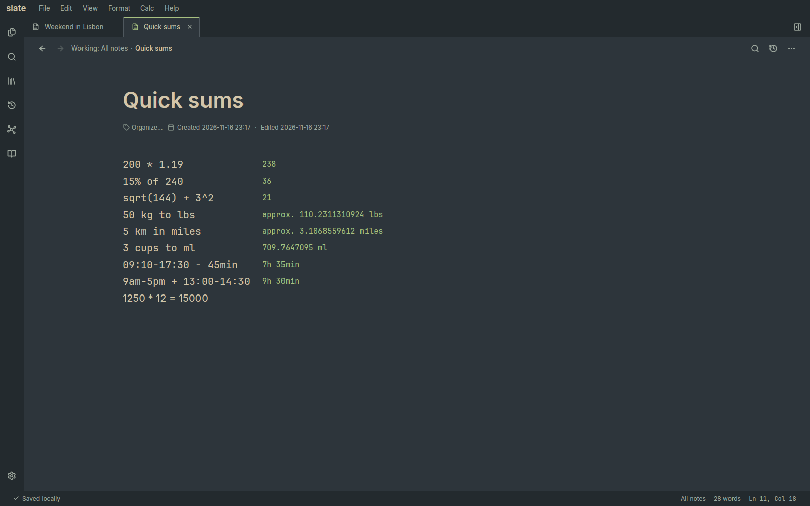
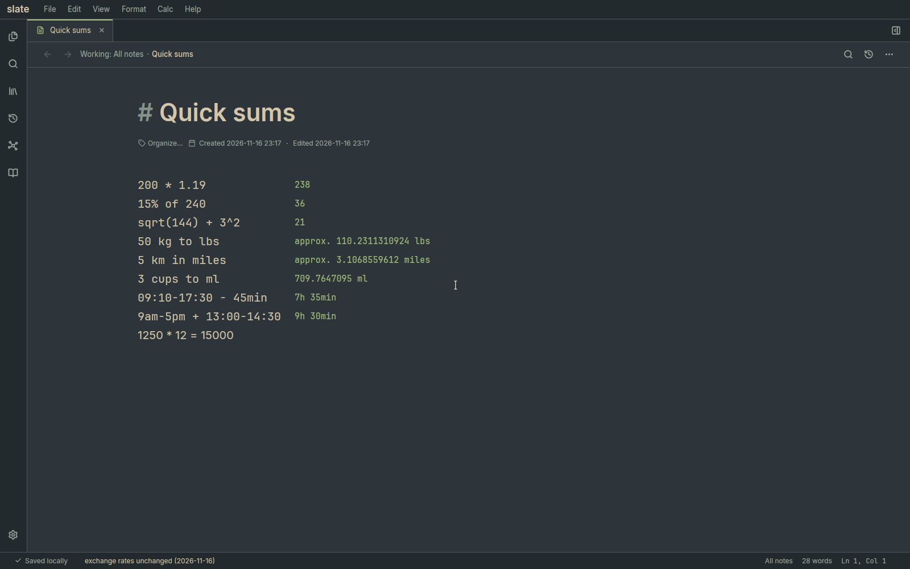
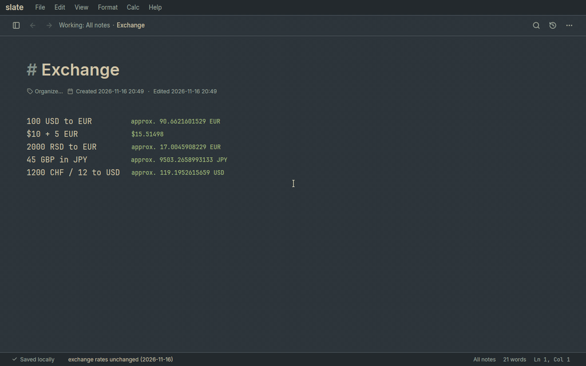
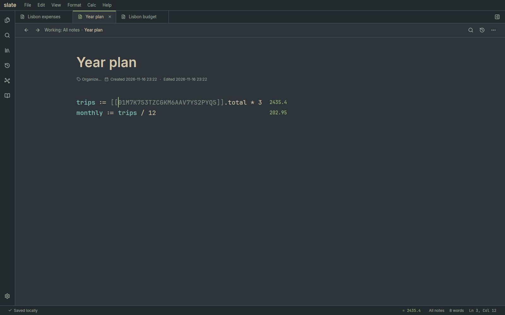
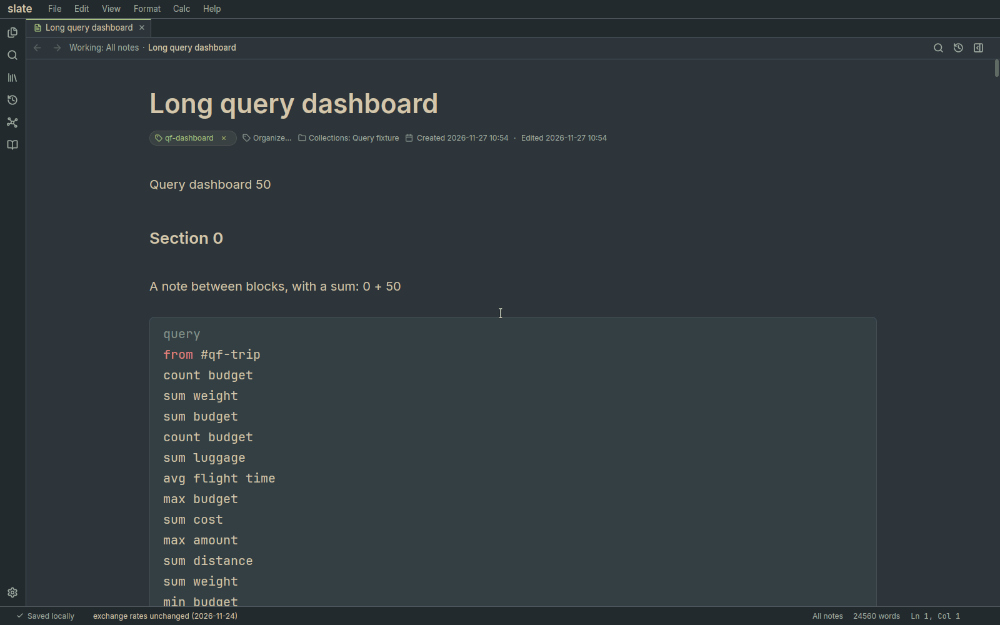
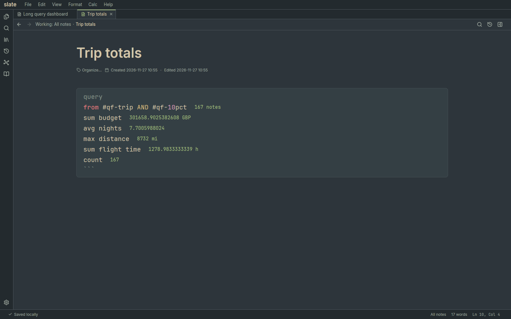

# Calculations, variables and currencies

Every line in Slate can be a calculator. Type something that adds up and
the answer appears, faintly, to the right of the line. Lines that are just
text stay quiet.

=== "Recording"

    

=== "Screenshot"

    [](media/calc.png)

## Calculations

```text
200 * 1.19                 238
15% of 240                 36
sqrt(144) + 3^2            21
50 kg to lbs               approx. 110.2311310924 lbs
5 km in miles              approx. 3.1068559612 miles
3 cups to ml               709.7647095 ml
```

Arithmetic, percentages, powers and roots, and conversions between units of
length, weight, volume, time, data and many more all work; the engine is
[fend](https://github.com/printfn/fend). Calculations also work inside list
items, checklist items and table cells. Lines that look like dates
(`2026-09-29`) are left alone.

**Keep the answer.** Press `Tab` at the end of a line to write its result
into the note (`1250 * 12` becomes `1250 * 12 = 15000`).

**Add things up.** `:sum` and `:avg` total or average the numbers in the
selection (or the whole note), insert the result and copy it.

## Clock times

Slate understands times of day and durations, so timesheets add up:

```text
09:10-17:30 - 45min        7h 35min
9am-5pm + 13:00-14:30      9h 30min
11:45 - 09:10              2h 35min
09:10 + 2h 30min           11:40
22:00-02:00                4h
(17:00 - 09:00) / 3        2h 40min
10:30-11:00 standup        30min
```

A range is two times joined by `-` without spaces, and runs past midnight
when it needs to. Words after a calculation are a label.

## Currencies

Convert between currencies the same way you convert units:

=== "Recording"

    

=== "Screenshot"

    [](media/currency.png)

```text
100 USD to EUR             approx. 90.6621601529 EUR
$10 + 5 EUR                $15.51498
2000 RSD to EUR            approx. 17.0045908229 EUR
45 GBP in JPY              approx. 9503.2658993133 JPY
```

Rates come from a small script you point Slate at. The repository includes
one that fetches about 160 daily rates from open.er-api.com:

```toml
[currency]
argv = ["python3", "/absolute/path/to/slate/scripts/examples/rates.py", "EUR"]
```

The last argument is your base currency. Slate keeps the last rates on disk,
so conversions work offline and right from startup; it fetches fresh rates
once in the background when it starts, and again on `:currency refresh`. The
status bar says when the rates were updated. Any program that prints rates
in the same JSON shape works; see [Currency rates](reference/scripting.md#currency-rates).

## Variables

Give a value a name with `:=` and use the name anywhere in the note:

=== "Recording"

    

=== "Screenshot"

    [](media/variables.png)

```text
nights := 3
hotel := nights * 74                 222
flights := 2 * 189.90                379.8
food := nights * 2 * 35              210
total := hotel + flights + food      811.8
total / 2                            405.9
in dollars := total EUR to USD       895.41…
```

Change `nights` to `5` and every line that depends on it updates at once.

- Names are not case-sensitive and may contain spaces (`in dollars`).
- If a name is assigned twice, the last assignment wins.
- After three letters (`[editor] variable_autocomplete_min_chars`), Slate
  suggests matching names; `Tab` or `Enter` accepts.
- A variable keeps its unit or currency: `budget := 2000 RSD to EUR` holds
  euros, so `budget * 2` is in euros too, and `weight := 120 kg` stays a mass.
  Adding a bare number to it (`weight + 5`) has no answer; write `weight + 5 kg`.
- Variable names are highlighted; in vim mode `gd` on a name jumps to where
  it is defined.
- Variables can hold clock times and durations too:
  `start := 09:10`, `lunch := 12:00-12:45`, then `17:30 - start - lunch`.

## Variables from other notes

A note can use a variable defined in another note: a link to the note, a
dot, and the variable's name. Type `[[`, pick the note (Slate writes its id
into the link and shows its title), press `Esc` to skip choosing a heading,
then type `.`: Slate lists that note's variables.

=== "Recording"

    

=== "Screenshot"

    [](media/cross-note.png)

```text
trips := [[01M7JWK8RMTRJ4X6RC7Y9CYH6E]].total * 3    3299.4
monthly := trips / 12                                 274.95
```

The other note doesn't need to be open. When its variables change, notes that
use them pick up the new values. `Ctrl+]` follows the link to the source note
and `Alt+Left` comes back. Away from the cursor the link reads
`Lisbon budget.total`; because it stores the id, renaming the note never
breaks it.

## Totals across notes

A `query` block adds up a variable over every note a search finds. Give each
trip note a `budget`, tag them `#trip`, and total them in one place:

=== "Recording"

    

=== "Screenshot"

    [](media/query.png)

````markdown
```query
from #trip
sum budget
avg budget
max budget
count
```
````

Answers appear beside each line, and the `from` line says how many notes were
read (`4 notes`). Like other calculation results they are never written into
the note.

- `from` takes the same search as `Ctrl+P` (`#trip AND coll:"2026"`), but not
  bare words; use `title:` or `#`.
- `sum`, `avg`, `min` and `max` take a variable name; notes without that
  variable are skipped. `count` counts the notes found, `count budget` those
  with a budget.
- Units and currencies convert: budgets in EUR, USD and CHF add up in one
  currency, and `120 kg` plus `30000 g` is `150 kg`. Values that cannot be
  added, such as kilograms and euros, show an error instead of a total.
- Totals update shortly after you stop editing the block, and when a note
  they read changes, including one changed by another app.
- The note holding the block is not counted, and encrypted notes are never
  read; the `from` line reports them (`2 protected skipped`). A block reads at
  most 5,000 notes.
- Blocks need the `math` and `cross_note` features on in the note holding
  them.

## Turning features off per note

Each note can switch calculation features on and off: `:module status` shows
them, and `:module math off` (or `table`, `variables`, `cross_note`, `style`)
switches one. Defaults for new notes are under `[editor.modules]` in the
config.

The full rules are in the [variables specification](reference/variables.md).
