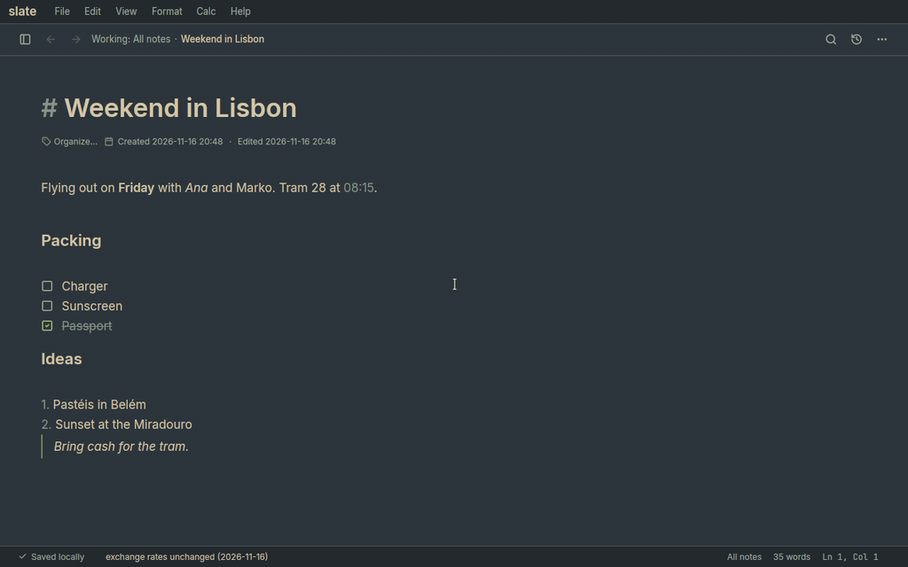
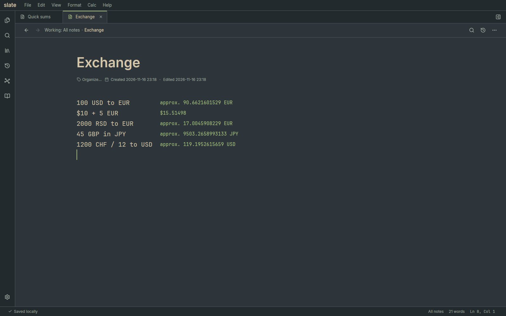
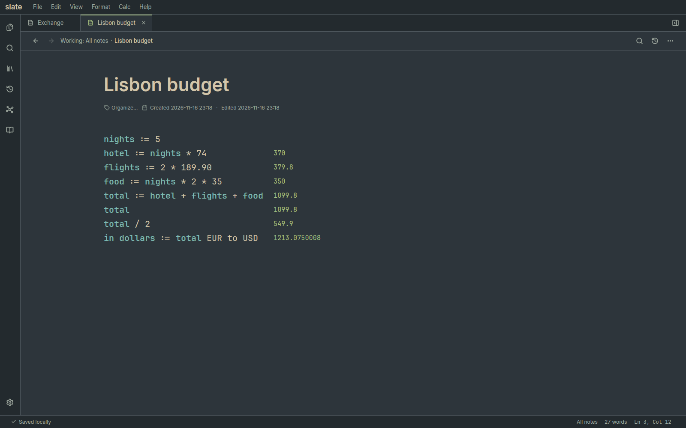
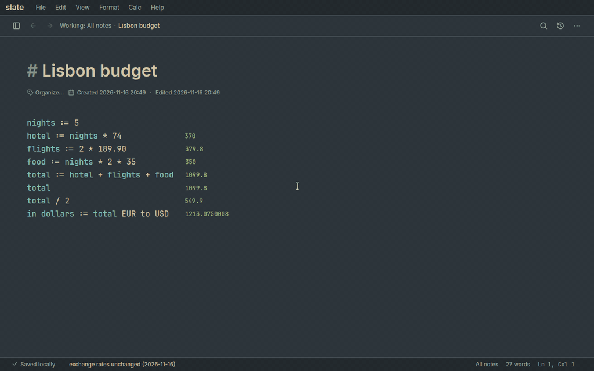

# Calculations, variables and currencies

Every line in Slate can be a calculator. Type something that adds up and
the answer appears, faintly, to the right of the line. Lines that are just
text stay quiet.

=== "Recording"

    

=== "Screenshot"

    [](media/calc.png)

## Calculations

```text
200 * 1.19                 238
15% of 240                 36
sqrt(144) + 3^2            21
50 kg to lbs               approx. 110.2311310924 lbs
5 km in miles              approx. 3.1068559612 miles
3 cups to ml               709.7647095 ml
```

Arithmetic, percentages, powers and roots, and conversions between units of
length, weight, volume, time, data and many more all work; the engine is
[fend](https://github.com/printfn/fend). Calculations also work inside list
items, checklist items and table cells. Lines that look like dates
(`2026-09-29`) are left alone.

**Keep the answer.** Press `Tab` at the end of a line to write its result
into the note (`1250 * 12` becomes `1250 * 12 = 15000`).

**Add things up.** `:sum` and `:avg` total or average the numbers in the
selection (or the whole note), insert the result and copy it.

## Clock times

Slate understands times of day and durations, so timesheets add up:

```text
09:10-17:30 - 45min        7h 35min
9am-5pm + 13:00-14:30      9h 30min
11:45 - 09:10              2h 35min
09:10 + 2h 30min           11:40
22:00-02:00                4h
(17:00 - 09:00) / 3        2h 40min
10:30-11:00 standup        30min
```

A range is two times joined by `-` without spaces, and runs past midnight
when it needs to. Words after a calculation are a label.

## Currencies

Convert between currencies the same way you convert units:

=== "Recording"

    

=== "Screenshot"

    [](media/currency.png)

```text
100 USD to EUR             approx. 90.6621601529 EUR
$10 + 5 EUR                $15.51498
2000 RSD to EUR            approx. 17.0045908229 EUR
45 GBP in JPY              approx. 9503.2658993133 JPY
```

Rates come from a small script you point Slate at. The repository includes
one that fetches about 160 daily rates from open.er-api.com:

```toml
[currency]
argv = ["python3", "/absolute/path/to/slate/scripts/examples/rates.py", "EUR"]
```

The last argument is your base currency. Slate keeps the last rates on disk,
so conversions work offline and right from startup; it fetches fresh rates
once in the background when it starts, and again on `:currency refresh`. The
status bar says when the rates were updated. Any program that prints rates
in the same JSON shape works; see [Currency rates](reference/scripting.md#currency-rates).

## Variables

Give a value a name with `:=` and use the name anywhere in the note:

=== "Recording"

    

=== "Screenshot"

    [](media/variables.png)

```text
nights := 3
hotel := nights * 74                 222
flights := 2 * 189.90                379.8
food := nights * 2 * 35              210
total := hotel + flights + food      811.8
total / 2                            405.9
in dollars := total EUR to USD       895.41…
```

Change `nights` to `5` and every line that depends on it updates at once.

- Names are not case-sensitive and may contain spaces (`in dollars`).
- If a name is assigned twice, the last assignment wins.
- After three letters (`[editor] variable_autocomplete_min_chars`), Slate
  suggests matching names; `Tab` or `Enter` accepts.
- A variable keeps its unit or currency: `budget := 2000 RSD to EUR` holds
  euros, so `budget * 2` is in euros too, and `weight := 120 kg` stays a mass.
  Adding a bare number to it (`weight + 5`) has no answer; write `weight + 5 kg`.
- Variable names are highlighted; in vim mode `gd` on a name jumps to where
  it is defined.
- Variables can hold clock times and durations too:
  `start := 09:10`, `lunch := 12:00-12:45`, then `17:30 - start - lunch`.

## Variables from other notes

A note can use a variable defined in another note: a link to the note, a
dot, and the variable's name. Type `[[`, pick the note (Slate writes its id
into the link and shows its title), press `Esc` to skip choosing a heading,
then type `.`: Slate lists that note's variables.

=== "Recording"

    

=== "Screenshot"

    [](media/cross-note.png)

```text
trips := [[01M7JWK8RMTRJ4X6RC7Y9CYH6E]].total * 3    3299.4
monthly := trips / 12                                 274.95
```

The other note doesn't need to be open. When its variables change, notes that
use them pick up the new values. `Ctrl+]` follows the link to the source note
and `Alt+Left` comes back. Away from the cursor the link reads
`Lisbon budget.total`; because it stores the id, renaming the note never
breaks it.

## Where a result comes from

Put the cursor on a line with a result and press `K` in vim mode, run
`:inspect`, or choose **Calc → Inspect result** in the desktop app. A panel
shows what the result was computed from:

```text
total := hours * rate + [[Lisbon trip]].travel     = 4298.7148860085 EUR
hours   48         line 4
rate    85 EUR     line 3
travel  240 USD    Lisbon trip
1 EUR = 1.0973 USD · rates of 2026-11-27
```

- Each variable the line reads, with its value and where it is defined: a
  line of this note, or another note. A plain value such as `x := 5`, which
  shows no result of its own, shows its definition instead.
- When more than one currency is involved, the exchange rates used and the
  date they were published.
- `Enter` (or a click in the desktop app) jumps to the selected definition,
  opening the other note when it is there; `Esc` closes.
- On a link, `K` previews the linked note instead.
- The panel shows one level: inspect an input's own line to see what that
  line reads.
- On a line whose calculation failed, the panel says why instead.

### Finding calculation problems

`]e` and `[e` in vim mode, `:problem next` and `:problem previous` (`:pn`,
`:pp`), or **Calc → Next / Previous calc problem** go to the next or previous
line whose calculation failed, and the status bar says why:

| Reason | Meaning |
| --- | --- |
| `x cannot be calculated` | The definition of `x` has no answer, for example because it uses a name never defined |
| `a depends on itself` | `a` is defined through itself, directly or through other variables |
| `b has no value` | `b` uses a variable that has no value |
| `price is not a number` | `price` gives text or a date rather than a number |
| `linked note not found: [[id]]` | The linked note was deleted |
| `Costs does not define nope` | The linked note has no variable of that name |

The note is checked once when you first ask, then again only after it, the
calculation settings or other notes' values change. A line that calc reads as
plain text, such as `5 kg + 3 m`, is not counted as a problem.

## Totals across notes

A `query` block adds up a variable over every note a search finds. Give each
trip note a `budget`, tag them `#trip`, and total them in one place:

=== "Recording"

    

=== "Screenshot"

    [](media/query.png)

````markdown
```query
from #trip
sum budget
avg budget
max budget
count
```
````

Answers appear beside each line, and the `from` line says how many notes were
read (`4 notes`). Like other calculation results they are never written into
the note.

### Writing a block

A block is a fenced code block with the language `query`. A note can hold
any number of them. Each line is one statement:

| Line | Shows |
| --- | --- |
| `from <search>` | Which notes are read: `12 notes` |
| `sum budget` | The total of `budget` over those notes |
| `avg budget` | The average, over the notes that have a `budget` |
| `min budget`, `max budget` | The smallest and largest value, as written in its note |
| `count` | How many notes the search found |
| `count budget` | How many of them have a `budget` |
| `// a comment` | Nothing; blank lines are fine too |

- `from` comes first, once per block. It takes the same search as the
  [note switcher](search.md#the-note-switcher): tags, collections, `title:`,
  `contains:`, `AND`, `OR`, `-` and parentheses, for example
  `from (#trip OR #weekend) AND coll:"2026" -#cancelled`. Plain words are not
  accepted, since they match titles loosely; write `title:lisbon` instead.
- Variable names work as in the note: case does not matter and spaces are
  allowed (`avg nights out`).

### Which values are read

Each note found contributes its variables as that note works them out,
including values it reads from other notes; if a name is assigned twice, the
last assignment counts. Notes without the variable are skipped, and when no
note has it the line says so.

- Units, currencies and durations are kept. Values of the same kind convert:
  budgets in EUR, USD and CHF add up in the currency of the first note that
  has one, and `120 kg` plus `30000 g` is `150 kg`.
- Values of different kinds, such as kilograms and euros, or a number
  without a unit next to one with, show an error naming the first note at
  fault, such as `values have incompatible units: Porto has 3 m`, instead of
  a partial total.
- `min` and `max` compare values after converting them, but show the winner
  as its note writes it, so the smallest of `1 kg` and `300 g` reads `300 g`.
- Results are shown to 10 decimal places, like other calculations.

### Which notes are behind a total

Put the cursor on a statement and press `K` in vim mode, run `:inspect`, or
choose **Calc → Inspect result**. Once the notes are read, a panel lists
them:

```text
sum budget          = values have incompatible units: Trip Rome has 3 kg
Trip Lisbon                                   120 EUR
Trip Porto                                    300 USD
unit does not fit (1)
Trip Rome                                       3 kg
without budget (1)
Trip Faro
4 notes
```

- The notes that count come first, largest first within each unit, then
  the notes whose unit does not fit and the notes without the variable.
  Up to 200 notes are listed of each kind (50 without the variable), then a
  count of the rest.
- On `count` or the `from` line the panel lists the matching notes.
- `Enter` (or a click in the desktop app) opens the selected note at the
  variable's definition. `Esc` gives up a list still being read.

### When answers update

- Answers are worked out in the background, one block at a time, so typing
  never waits for them. Only blocks on screen are worked out; scrolling to
  another block works it out then.
- After you edit a block, its answers return once you stop typing for a
  moment. They follow other notes too: when a note it reads changes, in
  either app, through another program or a sync, and when exchange rates are
  refreshed. The previous answer stays on screen until the new one is ready.
  When the change is known to touch values the block reads, such as new
  exchange rates or an edit in another open note, its `from` line adds
  `refreshing` meanwhile.
- Exports, PDFs and copied text show the block as written, without answers.

### What is left out

- The note holding the block is never counted, even if it matches.
- Encrypted notes are never read, even while unlocked. When the search only
  looks at tags, collections and titles, the `from` line counts the ones it
  skipped (`12 notes, 2 protected skipped`); a `contains:` search cannot look
  inside them, so it says `protected notes not searched`.
- Markdown files opened by path (`slate notes.md`) are not searched; a block
  inside one still totals the notes in Slate.
- A block reads at most 5,000 notes, the oldest first; past that the `from`
  line says `first 5,000 of 8,200 notes`.
- Answers cannot be used in calculations, variables or other blocks.
- Blocks need the `math` and `cross_note` features on in the note holding
  them (see below); otherwise the `from` line says so.

### Problems

A line that cannot be answered shows why, beside it:

| Message | Meaning |
| --- | --- |
| `add a from line to choose notes` | The block has no `from` line (shown on the opening fence) |
| `from must come first` | A statement comes before `from` |
| `only one from line` | A second `from` in the same block |
| `unknown statement 'total'; …` | The line is not one of the statements above |
| `sum needs a variable name` | `sum`, `avg`, `min` or `max` without a name |
| `search: …` | The search cannot be read, with the reason |
| `bare words match titles loosely; use title: or #` | The search has plain words |
| `no matching note exports budget` | No note found has that variable |
| `values have incompatible units: Porto has 3 m` | The values cannot be added or compared; the note named is the first whose unit does not fit |

## Turning features off per note

Each note can switch calculation features on and off: `:module status` shows
them, and `:module math off` (or `table`, `variables`, `cross_note`, `style`)
switches one. Defaults for new notes are under `[editor.modules]` in the
config.

The full rules are in the [variables specification](reference/variables.md).
