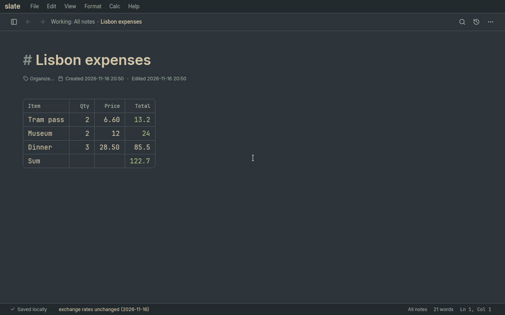
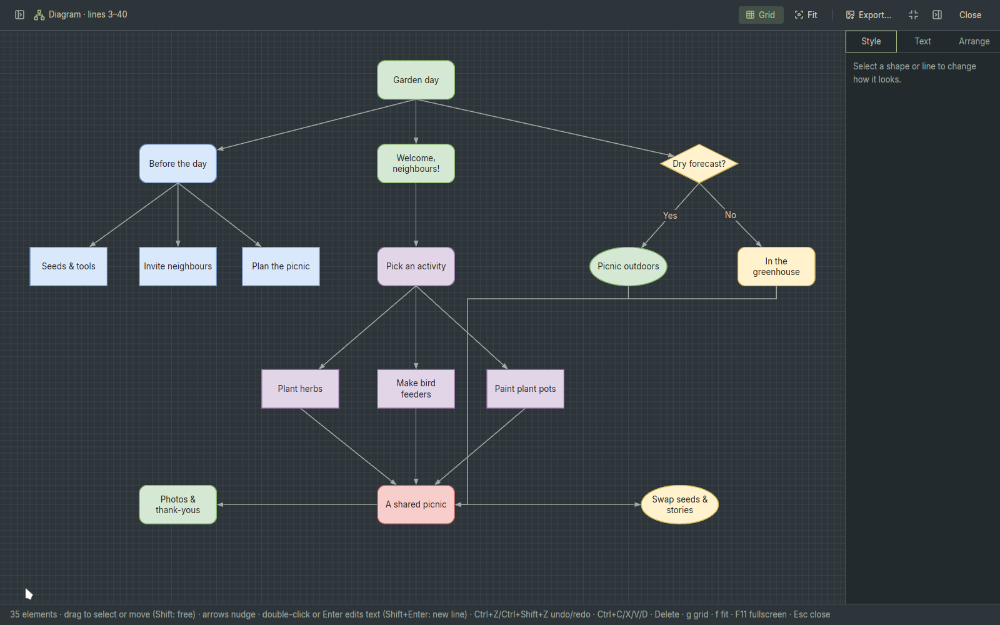

# Diagrams

Draw boxes, shapes and arrows right inside a note. A diagram is stored as a
short block of text in the note, so it is searched, versioned, exported and
synced like everything else, and the desktop app gives you a canvas to draw
it with the mouse.

=== "Recording"

    

=== "Screenshot"

    [](media/diagram-canvas.png)

*A day in the community garden: get ready, welcome the neighbours, choose an
activity, and plan for the weather. The build plays at a brisk pace, then
pauses on the finished plan. Tap the recording to expand it and zoom in.*

## Drawing on the canvas (desktop)

Run `:diagram` to insert a new diagram and open its canvas, or click a
diagram in a note to edit it.

| To | Do |
| --- | --- |
| Add a shape | Click or drag one from the **Shapes** panel, or point and press `r` (rectangle), `o` (rounded), `e` (ellipse), `d` (diamond), `t` (text), `c` (cylinder) |
| Write a label | `Enter`, `F2` or double-click; `Shift+Enter` for a new line |
| Connect two shapes | Hover a shape to show its dots, drag a dot onto another shape |
| Draw a free line | Pick one from the **Lines** panel, or drag a dot onto empty space |
| Move | Drag (snaps to the grid and lines up with other shapes; `Shift` moves freely), or arrow keys |
| Resize | Drag a corner of the selected shape |
| Bend a line | Select it and drag its handles |
| Select several | Drag a box around them, or `Shift`+click |
| Style | The **Style**, **Text** and **Arrange** tabs on the right: colours, line style and width, arrows, text size and alignment, position and size |
| Copy, paste, duplicate | `Ctrl+C`, `Ctrl+V`, `Ctrl+D` |
| Undo | `Ctrl+Z` (each gesture is one step in the note's undo) |
| Zoom | Scroll, `+`/`-`, `f` to fit |
| Full screen | `F11` |
| Close | `Esc` or **Close** |

**Arrange** also lines shapes up, spaces them evenly, and **Create next**
adds a matching shape beside the selected one, already connected.

There are fifteen shapes: rectangle, rounded, ellipse, diamond, text,
cylinder, callout, hexagon, clipped, triangle, actor, document, cloud, gear
and arrow.

## Exporting, and editing in draw.io

**Export…** on the canvas saves the diagram as **SVG** or **PNG** (1×, 2× or
3×, on a white or transparent background), or copies a PNG to the clipboard.

**An exported SVG opens for editing in [draw.io](https://www.drawio.com/)**
(diagrams.net). The SVG carries a draw.io copy of the diagram inside it:
open it with **File › Open** in draw.io, or name it `something.drawio.svg`
and draw.io, its desktop app and its VS Code extension treat it as an
editable diagram. Positions, labels, colours, line styles, connection points
and bends carry over. A few shapes become their nearest draw.io shape (a gear
becomes an ellipse), and draw.io draws curves its own way. Changes made in
draw.io stay in draw.io; they don't come back into the note.

PDF export draws diagrams as pictures; Markdown export keeps their text.

## The text behind a diagram

Each diagram is a fenced `diagram` block, one line per shape or connection:

````markdown
```diagram Garden day
node welcome rounded 0 40 150 60 "Welcome, neighbours!" fill=#d5e8d4
node weather rhombus 220 20 120 80 "Dry forecast?" fill=#fff2cc
node outside rounded 440 0 150 60 "Picnic outdoors" fill=#d5e8d4
node inside rounded 440 120 150 60 "In the greenhouse" fill=#e1d5e7
edge e1 welcome weather
edge e2 weather outside "Yes"
edge e3 weather inside "No" route=orthogonal
```
````

- `node <id> <shape> <x> <y> <width> <height> ["label"] [options]`
- `edge <id> <from> <to> ["label"] [options]`; an end can be a shape's id or
  a point `@x,y`
- Options include `fill=`, `stroke=` and `text=` colours, `dashed`,
  `dotted`, `stroke_width=`, `route=straight|orthogonal|curved`,
  `arrow=none|end|both`, `size=`, `bold`, `italic`, `align=` and more; see
  the [diagram reference](reference/features.md#diagrams).
- Text after `diagram` on the opening line is a caption, shown under the
  picture and in PDF exports.

You can edit this text directly: in the desktop app, putting the cursor in
the block shows the source with the picture under it, updating as you type.
The terminal app shows the source; `:diagram` there inserts an empty block.
