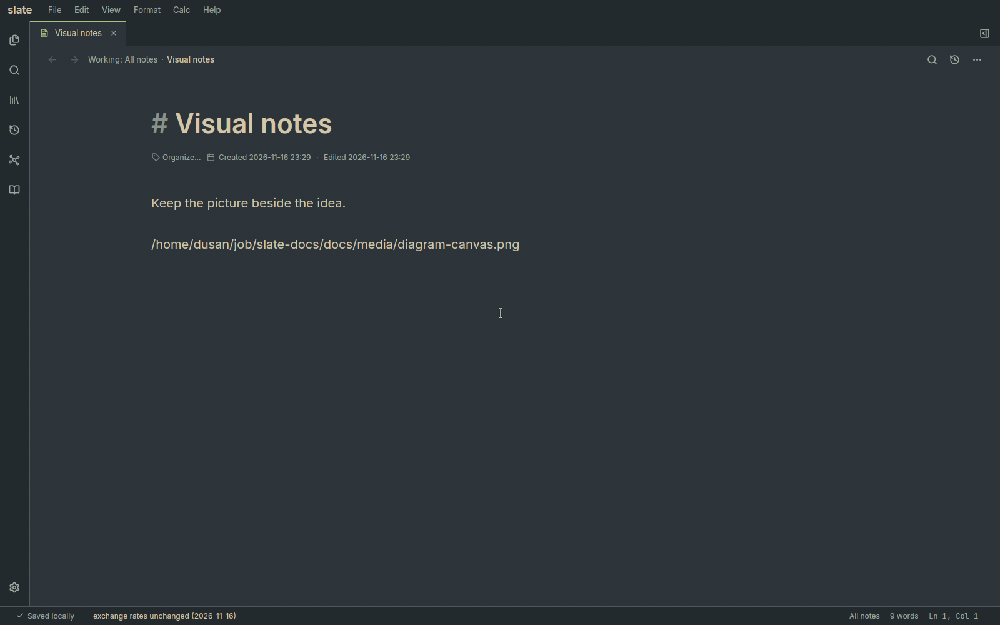

# Encryption

Any note, or a whole collection, can be locked with a password. Its text and
its history are stored encrypted; without the password they cannot be read,
not by Slate, not by an AI assistant, and not by anyone who copies your
database.



## Encrypt one note

1. Open the note and run `:note encrypt`.
2. Type a password, then type it again.

That's it. The note opens normally until you leave it alone: after 15
minutes without use it locks, and opening it asks for the password. In lists
it shows a padlock.

- `:note encrypt` on an unlocked encrypted note changes its password.
- `:note decrypt` stores it unencrypted again.
- In the desktop browser, `e` on a note encrypts or decrypts it.

## Encrypt a collection

A collection can have its own password, which protects every note in it at
once. Useful for a *Private* or *Work* collection whose notes should all be
locked without managing a password for each.

1. Open the browser (`Ctrl+B`, desktop Standard mode `Ctrl+Shift+B`).
2. Move to the collection in the collections column.
3. Press `e`, then type the password twice.

What happens then:

- **Every note in the collection is encrypted** with the collection's
  password, and so is every note that joins it later: notes created while it
  is your working collection, pasted into it in the browser, or added with
  `:collection join`.
- **One password unlocks them all.** Opening the collection, or any note in
  it, asks once and unlocks every note in it.
- **Notes stay tied to the collection.** While a note is in an encrypted
  collection it can't be decrypted on its own or given its own password; take
  it out of the collection (`:collection leave`) or decrypt the collection
  instead. A note that leaves keeps the collection's password until the
  collection is decrypted.
- **Notes that already had their own password keep it.** So do notes that
  belong to another encrypted collection.
- **The collection can't be deleted** while it still protects notes; on the
  desktop, deleting it first offers **Decrypt…**.
- **To undo it**, press `e` on the collection again and enter its password:
  its notes are stored unencrypted again.

## What is and isn't hidden

| Encrypted | Not encrypted |
| --- | --- |
| The note's text | The note's title (so you can find it; rename it to something vaguer, or clear the name to show "Encrypted note") |
| Every older version in its history | Its tags and collections |
| | Reminder text and attached images |

Encrypted notes are left out of text search, `:ask`, the MCP server and the
graph's links. The terminal app's window title shows only "Slate" while an
encrypted note is open.

## How it works

Each encrypted note is sealed with AES-256-GCM using its own random key. The
password doesn't encrypt the note directly; it unlocks that key (through
PBKDF2 with 200,000 rounds, which is deliberately slow to make guessing
expensive). That is why changing a password is instant: only the key is
re-wrapped, not the note.

**Keep your password safe.** There is no recovery: a forgotten password
means the note can't be opened.

## Encrypt everything by default

To make every new note encrypted, set a password in an environment variable
and point Slate at it:

```toml
[editor.security]
encrypt_notes = true
password_env = "SLATE_NOTES_PASSWORD"
```

Markdown files opened by path (`slate notes.md`) can't be encrypted; they
stay ordinary files.
