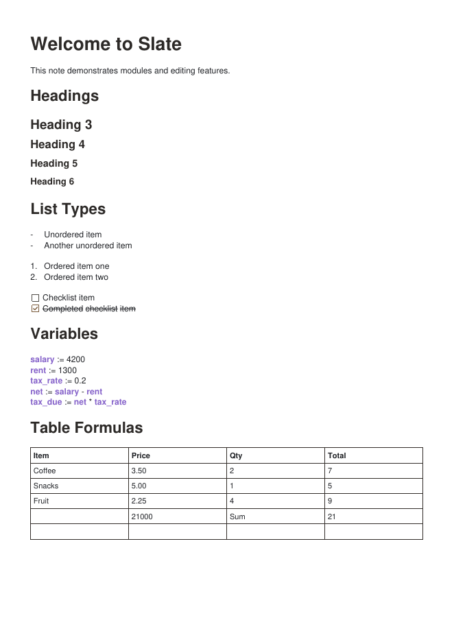

# Export, backup and email

## Export a note

| Command | Makes |
| --- | --- |
| `:export pdf ~/out/note.pdf` | A PDF with styled headings, lists, checklists, code, tables (with formula values), dividers, images and diagrams |
| `:export markdown [path]` | The note's Markdown, to a file or, without a path, the clipboard |
| `:export text [path]` | Plain text, to a file or the clipboard |



Diagrams export as pictures in PDFs and keep their source in Markdown; see
[Diagrams](diagrams.md#exporting-and-editing-in-drawio) for SVG and PNG
export and draw.io. More detail: [export reference](reference/export.md).

## Back up everything

| Command | Does |
| --- | --- |
| `:backup export ~/slate-backup.zip` | Back up the whole notebook (notes, history, tags, collections) into one ZIP, in the background |
| `:backup export md ~/notes-md` | Write every note as a Markdown file, in a folder per collection |
| `:backup load <path>` | Restore a ZIP backup, or add notes from a Markdown folder or ZIP |

Restoring a backup keeps your previous database as `notes.db.before-restore`,
just in case. Loading a Markdown folder adds its files as notes, which is
also how you bring notes in from other Markdown apps, an Obsidian vault
included. A Markdown backup also opens as an Obsidian vault.

## Email into notes (IMAP)

Slate can pull new email into your notes, so messages you want to act on sit
next to everything else. It reads mail over IMAP (with TLS) from any
provider; it does not send mail.

```toml
[imap]
host = "imap.example.com"
port = 993
username = "you@example.com"
password_env = "SLATE_IMAP_PASSWORD"   # the password is read from this variable
folder = "INBOX"
auto_sync_on_startup = true            # keep checking while Slate runs
poll_seconds = 60
initial_sync_past_days = 1             # how far back the first sync looks
```

- `slate imap-sync` checks once and exits (good for cron).
- With `auto_sync_on_startup = true`, Slate checks every `poll_seconds`
  while it runs and shows a desktop notification for new mail.
- Messages land in one inbox note per day (`inbox-email-2026-11-16`),
  newest first. Each message is imported once, never twice.

The password never goes into the config file: export it in the environment
Slate starts from, for example in your shell profile:

```sh
export SLATE_IMAP_PASSWORD='app-password-here'
```

Many providers (Gmail, Fastmail, iCloud) need an app password for IMAP.
