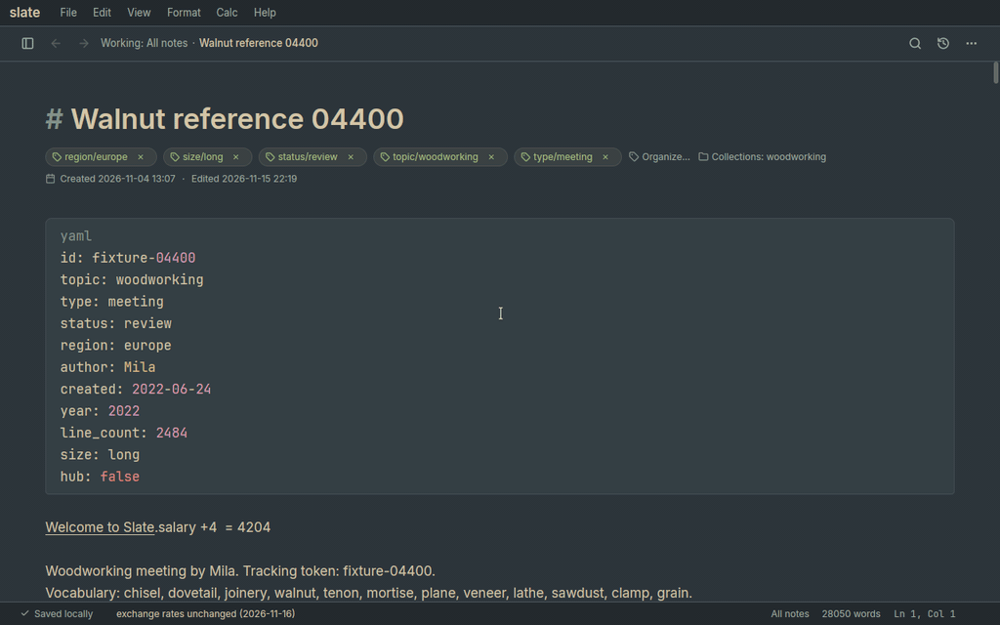
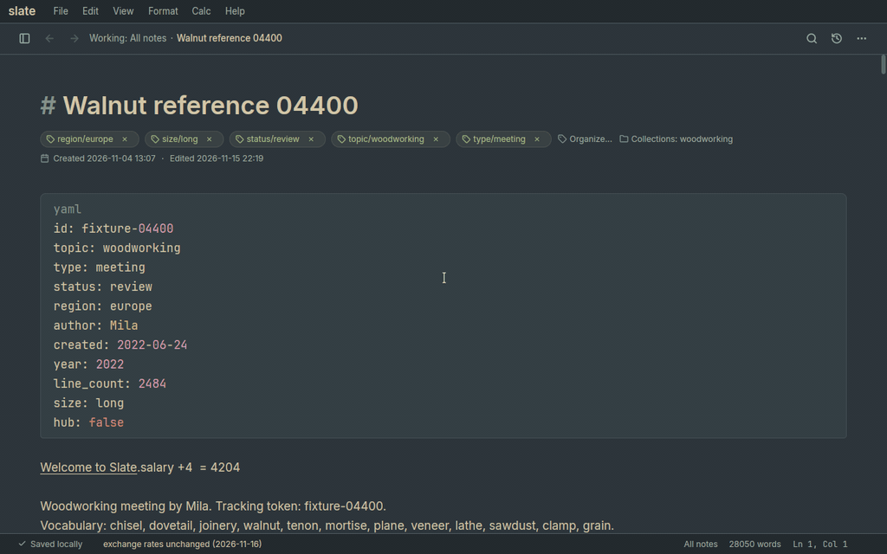

# Getting started

## Start Slate

| To | Desktop | Terminal |
| --- | --- | --- |
| Open your last note | `slate-gui` | `slate` |
| Start a new note | `Ctrl+N` | `slate --new` |
| Open today's daily note | `:today` | `slate today` |
| Open a Markdown file | `slate-gui notes/plan.md` | `slate notes/plan.md` |
| Open a note by its id | `slate-gui --id <id>` | `slate --id <id>` |

Slate opens on the note you had open last. A Markdown file opened by path
(`.md`, `.markdown`, `.mdown`, `.mkd`) is edited in place and saved back to
the same file; it does not go into the database.

## Your first note

Press `Ctrl+N` and start typing. The first line becomes the note's title
(start it with a letter and the desktop app makes it a `# ` heading for you).
There is no save button: Slate saves a moment after you stop typing, and
again whenever you switch notes or quit. `Ctrl+S` saves right away.

An empty note shows a short cheat sheet of what you can write until you type
the first key.

## Find your way around

A few keys get you almost everywhere:

| Key | What it opens |
| --- | --- |
| `Ctrl+P` | The note switcher: type part of a title, then `Enter` twice to jump to the best match |
| `Ctrl+N` | A new note |
| `Ctrl+E` | The command bar (`:` does the same in vim's Normal mode) |
| `Ctrl+B` | The browser: collections, notes and a preview (desktop Standard mode: `Ctrl+Shift+B`) |
| `F1` | Help: every shortcut with how it works, then every command |
| `Ctrl+Shift+P` | The command palette (desktop) |
| `F4` | Information about the open note |
| `Ctrl+Q` | Quit |

## Commands

Most of Slate is reachable through commands. Press `Ctrl+E`, type a few
letters, and suggestions appear: `exp` offers `export`, then its formats.
`Tab` or `Down` picks a suggestion, `Enter` runs it. Commands you used
recently come first. Mistype one and Slate suggests the closest
(`:colection` → did you mean `:collection`?).

`F1` opens help. On the desktop it is organized by topic (getting started,
moving around, editing, search, macros, links, tables, calculations,
commands, keyboard shortcuts); type to filter it. In both apps, `Enter` on a
command in help puts it in the command bar for you.

## Two editing modes

The desktop app has two editing modes, switched in **View › Editing mode**:

- **Standard** works like any other editor: `Shift`+arrows select,
  `Ctrl+Home`/`Ctrl+End` go to the start or end of the note,
  `Ctrl+C`/`X`/`V` copy, cut and paste, `Ctrl+B`/`Ctrl+I` make text bold or
  italic, `Ctrl+Z` undoes.
- **Vim** is modal editing with motions, operators, text objects, registers,
  macros and `.` repeat. See [Vim mode, macros and scripts](vim-and-scripts.md).

The terminal app is always modal, but it starts in Insert mode so you can
just type; `Esc` takes you to Normal mode. Set `[editor] vim_mode = true` to
start in Normal mode instead.

## Where your notes live

| What | Where (Linux) |
| --- | --- |
| Notes, tags, collections, history | `~/.local/share/slate/notes.db` (SQLite) |
| Desktop window and view settings | `~/.local/share/slate/gui-settings.json` |
| Configuration | `~/.config/slate/config.toml` |

The config file is created on first run with every setting listed. See
[Themes and configuration](themes-and-config.md).
