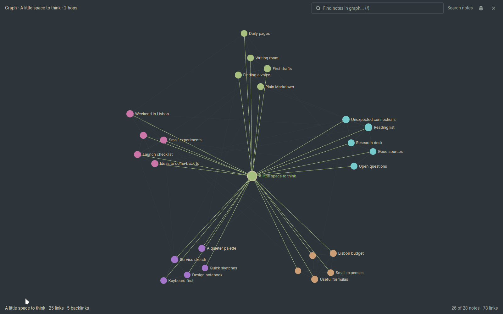
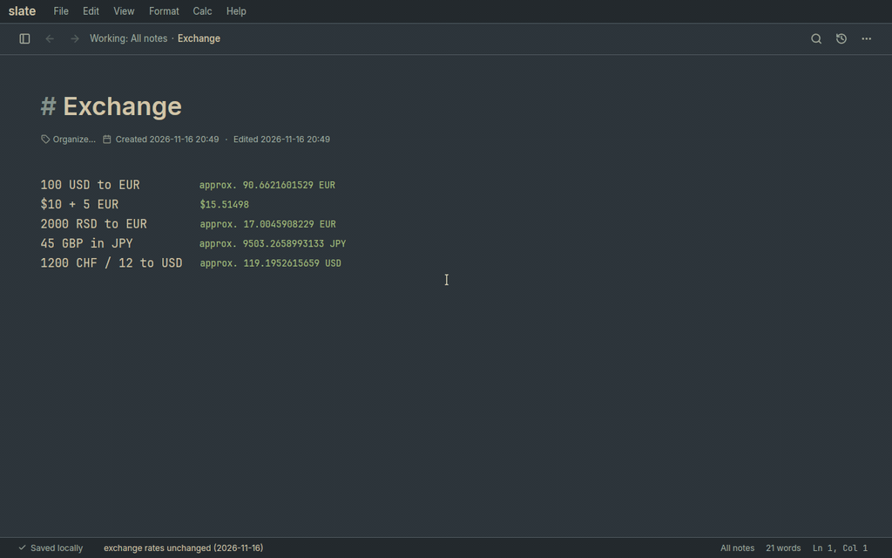
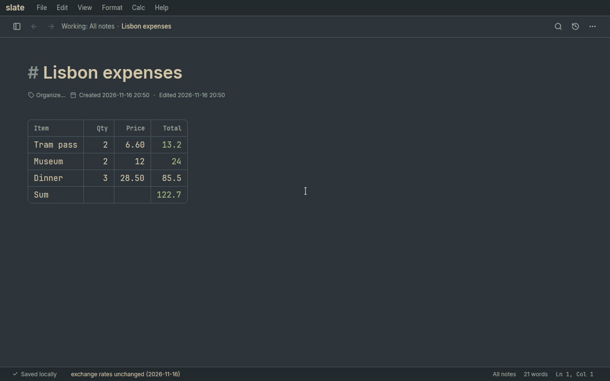
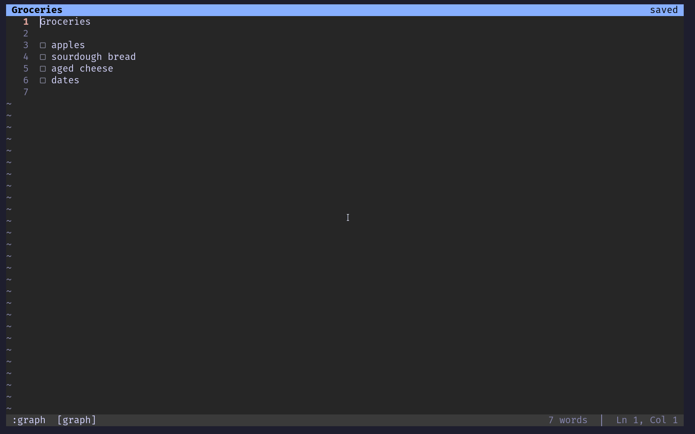
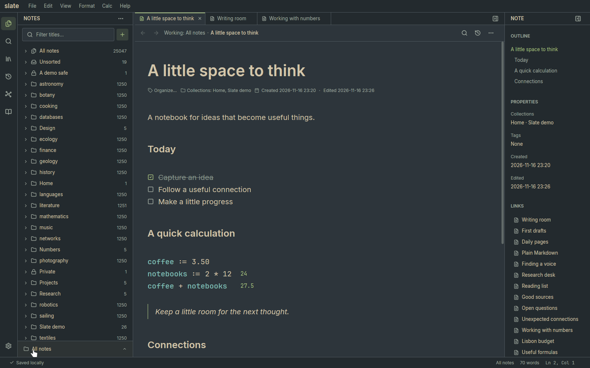

# Where your thoughts live. {#slate}

Write notes, work out numbers, and connect your ideas.
Use Slate on your desktop or in your terminal. Your notes stay on your computer.

[Start with Slate :octicons-arrow-right-24:](getting-started.md){ .md-button .md-button--primary }
[Explore the features](#see-slate-at-work){ .md-button }

:material-file-document-outline:{ aria-hidden="true" } Easy to export
:material-keyboard-outline:{ aria-hidden="true" } Keyboard first
:material-harddisk:{ aria-hidden="true" } Local by default

  
Your knowledge, connected <a class="slate-network__permalink" href="#slate" aria-label="Link to this introduction">¶</a>

  
  <svg class="slate-network__canvas" viewBox="0 0 560 560" role="group" aria-label="Explore a sample notebook. Each note links to its guide." hidden></svg>
  

    
<strong data-network-title>Ideas &amp; connections</strong>Hover a node to explore

  

  ↗ Drag nodes to explore

## See Slate at work

Choose a feature. Follow it from a first keystroke to a finished idea.

=== ":material-link-variant: Connected notes <small>Follow an idea</small>"

    ### One thought leads to another.

    Type `[[` to find a note, follow the link, then pick up where you left off.

    { loading=lazy }

    [Explore links and the graph :octicons-arrow-right-24:](links-and-graph.md)

=== ":material-pencil-outline: Writing <small>Make room for the words</small>"

    ### Write in the moment.

    Headings, checklists, emphasis and quotes take shape as you type. Your notes stay Markdown.

    { loading=lazy }

    [Find your writing flow :octicons-arrow-right-24:](writing.md)

=== ":material-calculator-variant-outline: Calculations <small>Think with numbers</small>"

    ### Let the notebook do the arithmetic.

    Name a value, build a budget, and change your mind. Everything that depends on it updates.

    { loading=lazy }

    [Try calculations and variables :octicons-arrow-right-24:](calculations.md)

=== ":material-table: Tables <small>A little structure</small>"

    ### Small tables. Useful answers.

    Paste your rows, add a formula, and let the totals take care of themselves.

    { loading=lazy }

    [Work with tables :octicons-arrow-right-24:](tables.md)

=== ":material-vector-square: Diagrams <small>Sketch the connection</small>"

    ### Draw the shape of an idea.

    Connect shapes on a fullscreen canvas. The diagram stays text inside your note.

    { loading=lazy }

    [Open the diagram guide :octicons-arrow-right-24:](diagrams.md)

=== ":material-console: Terminal <small>Same notebook. Different view.</small>"

    ### Take your notebook to the terminal.

    The same notes, search, collections and graph, with your hands on the keyboard—even over SSH.

    { loading=lazy }

    [Meet the terminal app :octicons-arrow-right-24:](terminal-app.md)

:material-monitor:{ aria-hidden="true" } Slate in motion
25,000 notes. One notebook.

*The desktop app on a notebook of 25,000 notes (4 GB): it finds a note from a
few letters of its title, opens a 6 MB note of almost 800,000 words, scrolls
it and searches inside it.*

## Two apps, one notebook

**Slate** (`slate-gui`) is the desktop app, with menus, mouse support, a
diagram canvas and a graph view. **slate** is the terminal app: the same
editor in any terminal, over SSH too, driven entirely from the keyboard. Both
read the same notes (`~/.local/share/slate/notes.db`) and the same config
(`~/.config/slate/config.toml`), and you can keep both open: a note changed
in one shows up in the other within a second. No accounts, no cloud.

## Explore

-   __Everything within reach__

    

    Keep your notes, outline and connections beside what you're writing.

    [:octicons-arrow-right-24: Find your way around](getting-started.md)

-   __See the bigger picture__

    

    Follow a connection, or group related notes to see how your ideas fit together.

    [:octicons-arrow-right-24: Explore the graph](links-and-graph.md#the-graph)

-   :material-rocket-launch-outline:{ .lg .middle } __Getting started__

    ---

    Open Slate, write your first note, find commands and help.

    [:octicons-arrow-right-24: Getting started](getting-started.md)

-   :material-pencil-outline:{ .lg .middle } __Writing__

    ---

    Markdown styled in place: lists, checklists, folding, images, dates and
    reminders.

    [:octicons-arrow-right-24: Writing](writing.md)

-   :material-calculator-variant-outline:{ .lg .middle } __Calculations__

    ---

    Any line is a calculator: units, clock times, currencies, variables, even
    values from other notes.

    [:octicons-arrow-right-24: Calculations](calculations.md)

-   :material-table:{ .lg .middle } __Tables__

    ---

    Tables that align themselves, with formula cells and column totals.

    [:octicons-arrow-right-24: Tables](tables.md)

-   :material-graph-outline:{ .lg .middle } __Links and the graph__

    ---

    Wiki links between notes, and a map of how 25,000 of them connect.

    [:octicons-arrow-right-24: Links and the graph](links-and-graph.md)

-   :material-magnify:{ .lg .middle } __Search__

    ---

    One query language for titles, tags, collections and full text.

    [:octicons-arrow-right-24: Search](search.md)

-   :material-folder-multiple-outline:{ .lg .middle } __Organizing__

    ---

    Collections, tags, pins, the browser, version history, daily notes and
    quick capture from the shell.

    [:octicons-arrow-right-24: Organizing](organizing.md)

-   :material-vector-square:{ .lg .middle } __Diagrams__

    ---

    Draw on a canvas; the diagram stays text in your note and exports to SVG
    you can edit in draw.io.

    [:octicons-arrow-right-24: Diagrams](diagrams.md)

-   :material-export-variant:{ .lg .middle } __Export, backup and email__

    ---

    PDF and Markdown export, full backups, and email pulled into notes.

    [:octicons-arrow-right-24: Export, backup and email](export-backup-email.md)

-   :material-keyboard-outline:{ .lg .middle } __Vim mode and scripts__

    ---

    Modal editing, macros, your own key bindings and scripts.

    [:octicons-arrow-right-24: Vim mode and scripts](vim-and-scripts.md)

-   :material-robot-outline:{ .lg .middle } __AI__

    ---

    Ask Claude Code or Codex about a note, and let AI assistants work with
    your notes over MCP.

    [:octicons-arrow-right-24: AI](ai.md)

-   :material-lock-outline:{ .lg .middle } __Encryption__

    ---

    Lock a note, or a whole collection, with a password.

    [:octicons-arrow-right-24: Encryption](encryption.md)

-   :material-palette-outline:{ .lg .middle } __Themes and configuration__

    ---

    Fourteen color schemes, fonts, and every setting worth knowing.

    [:octicons-arrow-right-24: Themes and configuration](themes-and-config.md)

-   :material-speedometer:{ .lg .middle } __Performance__

    ---

    Why Slate stays fast with huge notes and large notebooks.

    [:octicons-arrow-right-24: Performance](performance.md)

-   :material-console:{ .lg .middle } __The terminal app__

    ---

    The whole of Slate in a terminal.

    [:octicons-arrow-right-24: The terminal app](terminal-app.md)

-   :material-book-open-variant:{ .lg .middle } __Reference__

    ---

    Every feature, key, command and setting.

    [:octicons-arrow-right-24: Feature reference](reference/features.md)

## About the recordings

The animations and screenshots were recorded from the current apps on Linux
in a fullscreen 1600 × 1000 workspace. The GIFs retain that resolution;
tap a recording to open it full-screen and zoom in for the details.

The demo notebook has more than 25,000 notes, plus a small set of connected
example notes for the graph. Most desktop recordings use Everforest Dark;
the terminal recordings use Catppuccin Mocha. They are made by
[`scripts/capture.py`](https://github.com/dborovcanin/slate-docs/blob/main/scripts/capture.py),
so they can be recorded again whenever the apps change.
