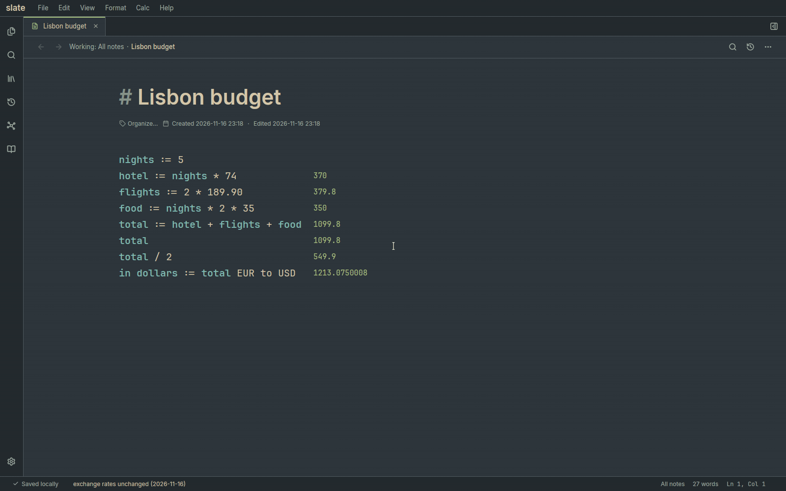

# Slate

Fast, keyboard-first notes for your desktop and your terminal. Plain
Markdown, styled as you type. Every line can calculate, tables hold
formulas, notes link to each other, and everything stays on your computer.

[Get started](getting-started.md){ .md-button .md-button--primary }
[See all features](reference/features.md){ .md-button }

*The desktop app on a notebook of 25,000 notes (4 GB): it finds a note from a
few letters of its title, opens a 6 MB note of almost 800,000 words, scrolls
it and searches inside it.*

## Two apps, one notebook

**Slate** (`slate-gui`) is the desktop app, with menus, mouse support, a
diagram canvas and a graph view. **slate** is the terminal app: the same
editor in any terminal, over SSH too, driven entirely from the keyboard. Both
read the same notes (`~/.local/share/slate/notes.db`) and the same config
(`~/.config/slate/config.toml`), and you can keep both open: a note changed
in one shows up in the other within a second. No accounts, no cloud.

## Explore

-   :material-rocket-launch-outline:{ .lg .middle } __Getting started__

    ---

    Install, write your first note, find commands and help.

    [:octicons-arrow-right-24: Getting started](getting-started.md)

-   :material-pencil-outline:{ .lg .middle } __Writing__

    ---

    Markdown styled in place: lists, checklists, folding, images, dates and
    reminders.

    [:octicons-arrow-right-24: Writing](writing.md)

-   :material-calculator-variant-outline:{ .lg .middle } __Calculations__

    ---

    Any line is a calculator: units, clock times, currencies, variables, even
    values from other notes.

    [:octicons-arrow-right-24: Calculations](calculations.md)

-   :material-table:{ .lg .middle } __Tables__

    ---

    Tables that align themselves, with formula cells and column totals.

    [:octicons-arrow-right-24: Tables](tables.md)

-   :material-graph-outline:{ .lg .middle } __Links and the graph__

    ---

    Wiki links between notes, and a map of how 25,000 of them connect.

    [:octicons-arrow-right-24: Links and the graph](links-and-graph.md)

-   :material-magnify:{ .lg .middle } __Search__

    ---

    One query language for titles, tags, collections and full text.

    [:octicons-arrow-right-24: Search](search.md)

-   :material-folder-multiple-outline:{ .lg .middle } __Organizing__

    ---

    Collections, tags, pins, the browser, version history, daily notes and
    quick capture from the shell.

    [:octicons-arrow-right-24: Organizing](organizing.md)

-   :material-vector-square:{ .lg .middle } __Diagrams__

    ---

    Draw on a canvas; the diagram stays text in your note and exports to SVG
    you can edit in draw.io.

    [:octicons-arrow-right-24: Diagrams](diagrams.md)

-   :material-export-variant:{ .lg .middle } __Export, backup and email__

    ---

    PDF and Markdown export, full backups, and email pulled into notes.

    [:octicons-arrow-right-24: Export, backup and email](export-backup-email.md)

-   :material-keyboard-outline:{ .lg .middle } __Vim mode and scripts__

    ---

    Modal editing, macros, your own key bindings and scripts.

    [:octicons-arrow-right-24: Vim mode and scripts](vim-and-scripts.md)

-   :material-robot-outline:{ .lg .middle } __AI__

    ---

    Ask Claude Code or Codex about a note, and let AI assistants work with
    your notes over MCP.

    [:octicons-arrow-right-24: AI](ai.md)

-   :material-lock-outline:{ .lg .middle } __Encryption__

    ---

    Lock a note, or a whole collection, with a password.

    [:octicons-arrow-right-24: Encryption](encryption.md)

-   :material-palette-outline:{ .lg .middle } __Themes and configuration__

    ---

    Fourteen color schemes, fonts, and every setting worth knowing.

    [:octicons-arrow-right-24: Themes and configuration](themes-and-config.md)

-   :material-speedometer:{ .lg .middle } __Performance__

    ---

    Why Slate stays fast with huge notes and large notebooks.

    [:octicons-arrow-right-24: Performance](performance.md)

-   :material-console:{ .lg .middle } __The terminal app__

    ---

    The whole of Slate in a terminal.

    [:octicons-arrow-right-24: The terminal app](terminal-app.md)

-   :material-book-open-variant:{ .lg .middle } __Reference__

    ---

    Every feature, key, command and setting.

    [:octicons-arrow-right-24: Feature reference](reference/features.md)

## About the recordings

The animations were recorded from the real apps on Linux, over a demo
notebook of 25,000 generated notes, in the desktop app's Everforest Dark
theme and the terminal app's Catppuccin Mocha scheme. They are made by
[`scripts/capture.py`](https://github.com/dborovcanin/slate-docs/blob/main/scripts/capture.py),
so they can be recorded again whenever the apps change.
