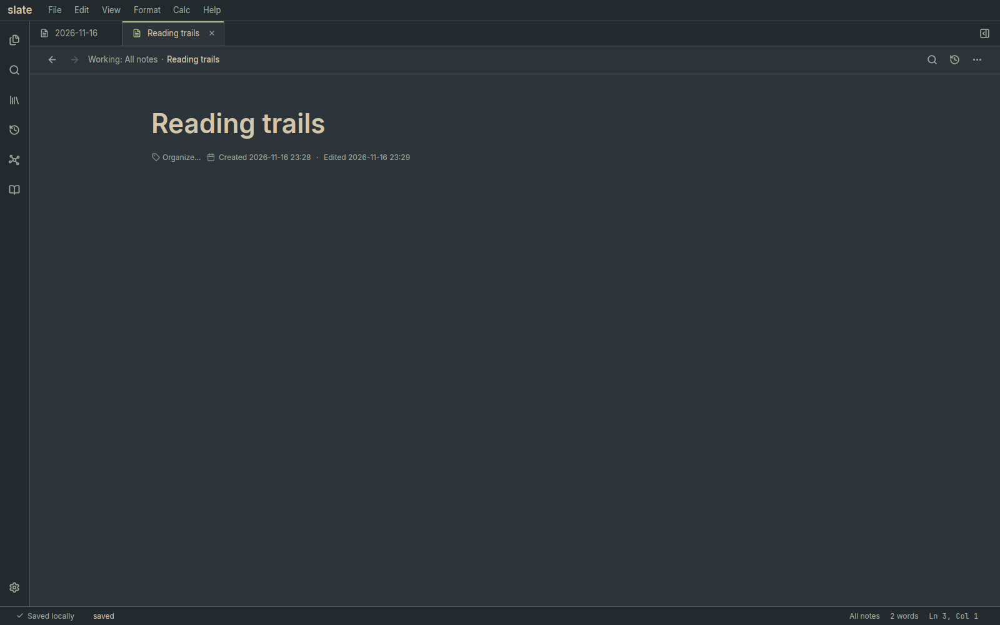
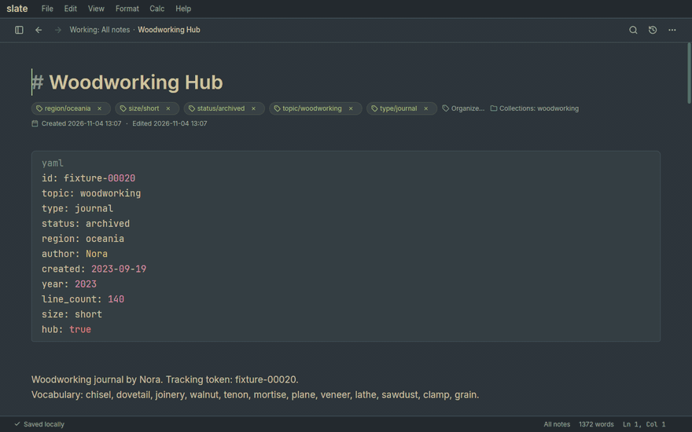
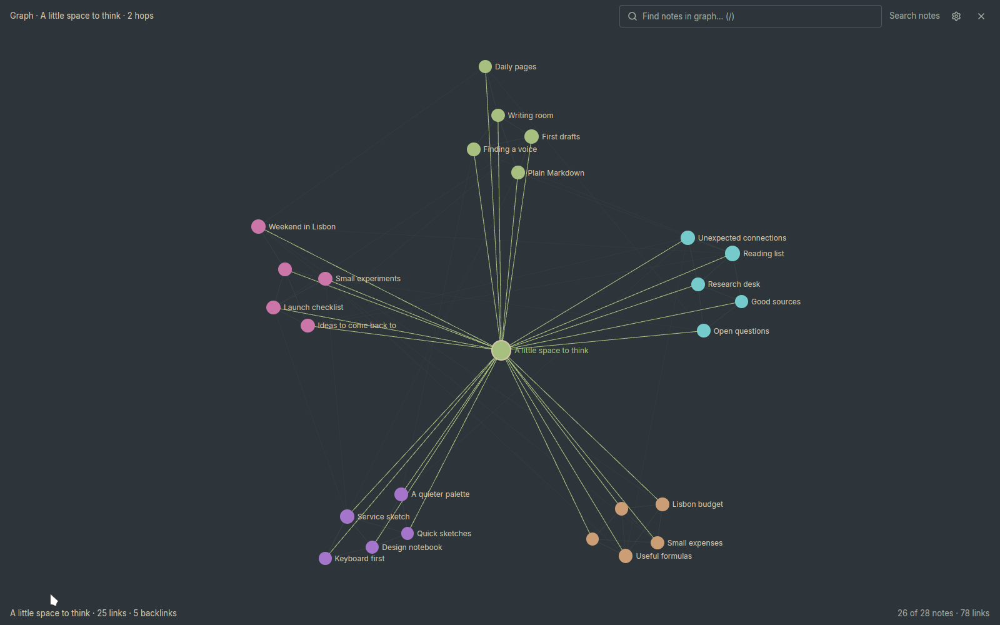
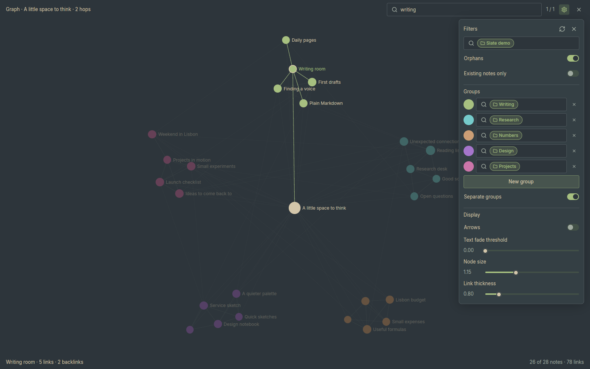

# Links and the graph

## Linking notes

Type `[[` and a note picker opens. Type part of a title, then `Tab` or
`Enter` to pick a note. Slate then offers that note's headings; pick one to
link straight to it, or press `Esc` to link the whole note.

Away from the cursor a link shows the note's title, underlined. Underneath it
stores the note's id (`[[01M7JWK8RMTRJ4X6RC7Y9CYH6E]]`), so renaming the
other note never breaks the link.

| Key | Does |
| --- | --- |
| `[[` | Insert a link and open the note picker |
| `Ctrl+]` (vim also `gd`) | Follow the link at the cursor |
| `Alt+Left` / `Alt+Right` (desktop) | Back and forward through the notes you visited |
| `K` (vim Normal) | Preview the linked note in a popup |
| `Ctrl+K` (desktop Standard mode) | Insert a link |

A link can carry a heading and its own label: `[[id#Heading]]`,
`[[id|label]]`, `[[id#Heading|label]]`. A link to a note that no longer
exists shows `(no such note)` and comes back to life if the note does.

Links also carry values: `[[id]].total` uses the variable `total` from the
linked note (see [Variables from other notes](calculations.md#variables-from-other-notes)).

Ordinary web links, `[text](https://…)`, are styled too.

## The graph

`:graph` (desktop: **File › Note graph…**) draws your notes as dots and their links
as lines, starting from the open note and the notes within two links of it,
in both directions.

=== "Recording"

    

=== "Screenshot"

    

*The recording follows 26 example notes inside the larger demo notebook.
Writing, research, numbers, design and projects each have their own color
group. Selecting a note highlights its connections.*

| Key | Does |
| --- | --- |
| Arrow keys or `h` `j` `k` `l` | Select the nearest note in that direction |
| `Tab` / `Shift+Tab` | Step through all notes |
| `Enter`, double-click | Open the selected note |
| `c` or `Space` | Recentre on the selected note |
| `+` / `-` | More or fewer link hops (1 to 4) |
| `w` | Switch between the local graph and every note |
| `/` (desktop also `Ctrl+F`) | Find notes in the graph by title; `n` / `N` step through matches |
| Scroll, drag (desktop) | Zoom, pan, or drag a note around |
| `Esc` | Close the graph |

On the desktop, hovering or selecting a note brightens it and its
neighbours while everything else fades. `f` or the gear button opens
**Filters**:

- **Filter** hides notes that don't match a search query (same syntax as the
  [note switcher](search.md)), for example `#topic/sailing -#status/draft`.
- **Orphans** and **Existing notes only** hide unlinked notes and links to
  missing notes.
- **Groups** color the notes matching a query, each in its own circle, so a
  topic or tag stands out. Click a group's swatch to pick its color.
- **Display** adds arrows, and scales dots, lines and labels.

Filters, groups and display options are remembered.

*Color groups can use the same queries as search. Here, each collection gets
its own region, making related notes easy to spot.*

In the terminal the graph is drawn with characters: `◆` is the centre note,
`◉` the selection and `○` a link to a missing note. `]` and `[` zoom,
`Shift+H`/`J`/`K`/`L` pan, and `0` shows the whole graph again.

The first time you open the graph Slate reads every note's links once
("Indexing links…"); after that only notes you changed are read again, so it
opens at once.
