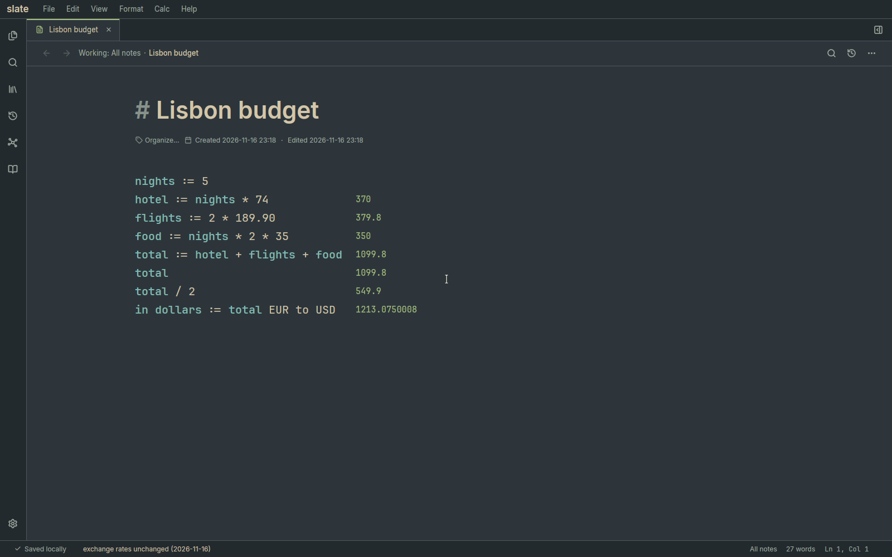
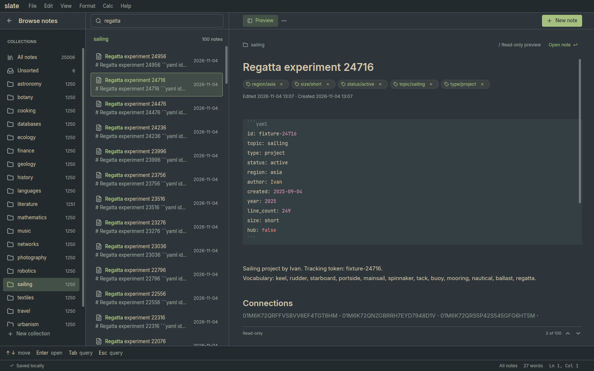
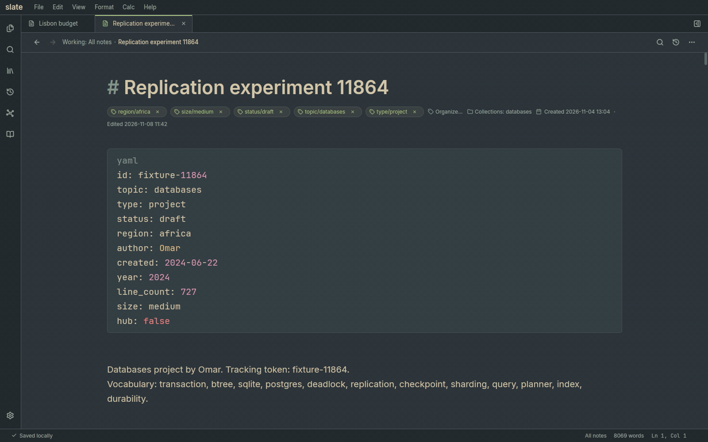
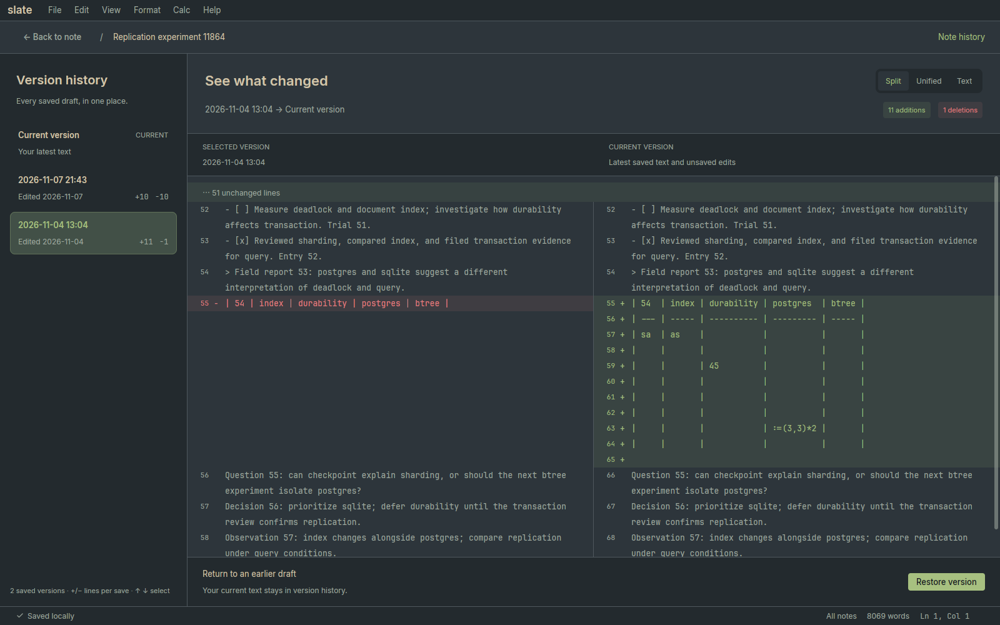
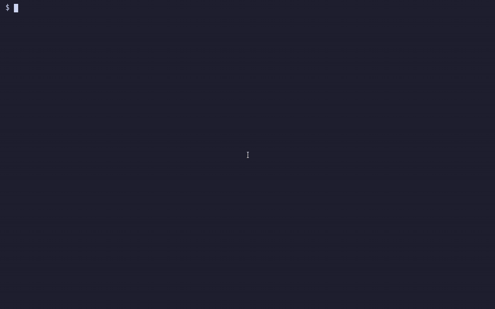
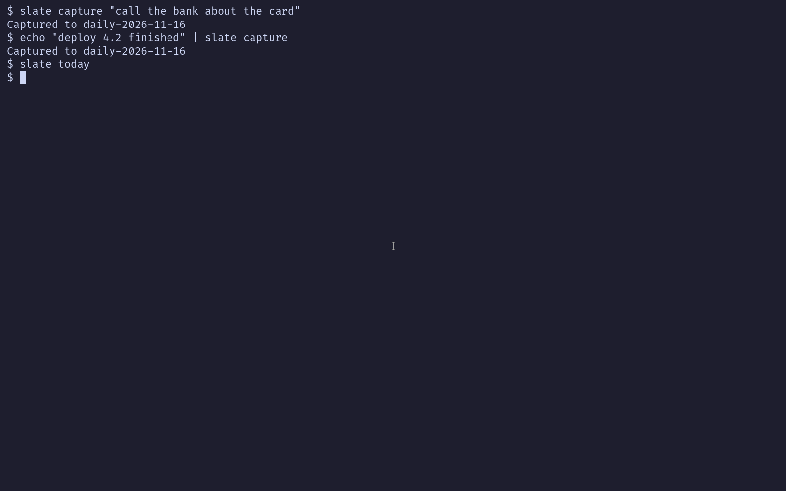

# Organizing

Slate gives you three ways to arrange notes, and they combine freely:

- **Collections** are like folders, except a note can be in several.
- **Tags** label notes across collections (`meeting`, `idea`, `topic/sailing`).
- **Pins** keep favourites at the top of every list.

## Collections

| Command | Does |
| --- | --- |
| `:collection create Work` | Create a collection |
| `:collection choose Work` (or `Ctrl+G`) | Make it the *working collection* |
| `:collection choose none` | Back to all notes |
| `:collection join Work` / `leave Work` | Add the open note to it / take it out |
| `:collection update Work` | Rename it, describe it, set default tags for new notes |
| `:collection delete Work` | Delete the collection, keeping its notes |
| `:collection purge Work` | Delete the collection and its notes |

The working collection is where new notes go, and the note switcher looks
there first (`Ctrl+L` switches to all notes). Set
`[startup] default_collection = "Work"` to start in one.

## Tags

`:tag add work` and `:tag remove work` change the open note's tags.
`:organize` (or clicking the tags on the desktop) opens a dialog listing the
note's tags and collections first, then all the others; type to find or
create one, `Enter` adds or removes it. Tags are separate from the note's
text, so adding one never changes what you wrote.

## Pins

`:note pin` pins the open note; `P` in the browser pins a note or collection.
Pinned items come first in the browser and pickers.

## The browser

`Ctrl+B` (desktop Standard mode: `Ctrl+Shift+B`) opens a three-column
browser, like a file manager: collections, the notes in the open collection,
and a live preview.

=== "Recording"

    

=== "Screenshot"

    [](media/browser.png)

| Key | Does |
| --- | --- |
| type | Filter note titles (the filter has focus when it opens) |
| `Esc` | Leave the filter to move around |
| `j`/`k`, arrows | Move |
| `Tab` (desktop), `h`/`l` | Between the collections and the notes |
| `Enter`, `o` | Open the note or collection |
| `Ctrl+F` | Search the text of the notes in this collection |
| `t` / `T` | Edit the note's tags / filter by tags |
| `Space`, `Ctrl+A` | Select notes |
| `y` then `p` | Add the selected notes to another collection |
| `x` then `p` | Move them there |
| `d` | Take them out of this collection (they stay in your notes) |
| `D` | Delete them (asks first) |
| `u` | Undo the last paste or removal |
| `n` / `r` | New note / rename |
| `e` | Encrypt or decrypt a collection or note (see [Encryption](encryption.md)) |
| `H` | The note's history |
| `s` | Sort by date or title |
| `a` or `?` | All actions for what is selected |

*Unsorted* lists notes in no collection. Lists load in pages as you scroll,
so the browser opens instantly even with tens of thousands of notes.

## Note history

Slate keeps older versions of every note, automatically. Edits a few minutes
apart count as one session, and each session keeps the text from before it.
Versions store only the lines that changed, so even large notes cost little.
Old versions thin out over time: everything from the last day, then one per
day for a month, then one per week.

=== "Recording"

    

=== "Screenshot"

    [](media/history.png)

Open it with `:history`, `H` in the browser or `Ctrl+R` in the note switcher.
Pick a version to see what restoring it would change (split or unified on
the desktop), `Tab` shows the version's text, and `Enter` restores it after
asking. Restoring is itself kept as a version, so nothing is ever lost.

## Note info

`F4` or `:info` shows the open note's title, id, tags, collections, when it
was created and last saved, and whether it is encrypted.

## Daily notes and quick capture

`:today` (or `slate today` from a shell) opens today's note, creating it from
a template. From the shell you can drop a line into it without opening
Slate, which works well with scripts, cron jobs and key bindings:

=== "Recording"

    

=== "Screenshot"

    [](media/capture.png)

```sh
slate capture call the bank about the card     # adds "- 20:37 call the bank…"
echo "deploy 4.2 finished" | slate capture     # captures piped text
make test 2>&1 | slate append                  # appends output to the last edited note
make test 2>&1 | slate append --id <note-id>   # …or to a given note
slate --list                                   # list notes
```

The daily note's id prefix and template are set under `[daily]`:

```toml
[daily]
note_prefix = "daily"
template = "# {date}\n\n"
```
