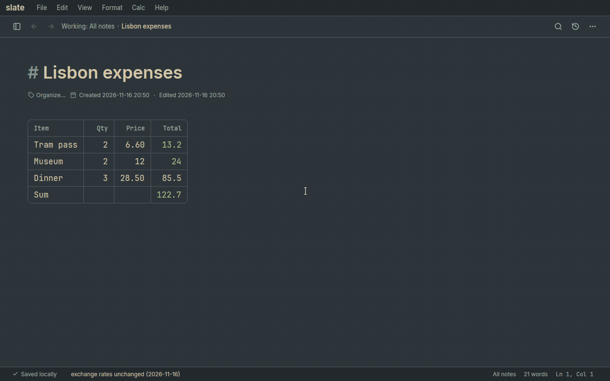
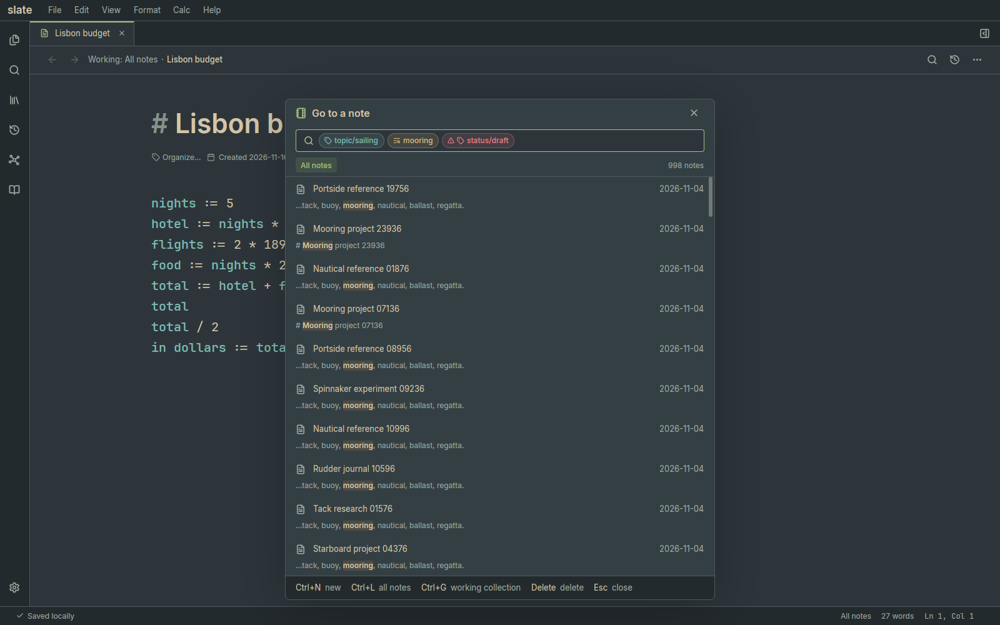

# Search

Slate has one search language, used everywhere you look for notes, plus a
quick find inside the open note.

| Where | Key | Searches |
| --- | --- | --- |
| Note switcher | `Ctrl+P` | Titles, tags, collections and text of all notes |
| Find in note | `Ctrl+F` (vim: `/`) | The open note |
| Browser filter and text search | `Ctrl+B`, then type / `Ctrl+F` | Titles, or text within a collection |
| Sidebar search (desktop) | `Ctrl+Shift+F` | Titles and text |
| Graph find and filter | `/`, `f` in the graph | Notes in the graph |
| Heading picker | `:toc` | Headings of the open note |
| Web lookup | `:lookup` | The web |

## The note switcher

`Ctrl+P`, type a few letters, then `Enter` twice: the first moves from the
search box to the results with the best match picked, the second opens it
(or use `Down`/`Up` to pick another first). Plain words match titles
fuzzily and in order: `photo 116` finds *Photometry project 11681*. The
switcher shows each note's collections and tags, and the best match comes
first.

=== "Recording"

    

=== "Screenshot"

    [](media/search.png)

Add fields to narrow it down:

| Write | Finds notes |
| --- | --- |
| `title:"daily log"` | Whose title contains the phrase |
| `#work` or `tag:work` | Tagged `work` |
| `coll:Work` or `collection:"Work notes"` | In that collection |
| `contains:"release date"` or `text:` | Whose text contains the phrase |
| `-#draft`, `NOT title:old` | Without the tag, or not matching |
| `(#work OR #home) AND -title:draft` | Combinations; `AND` binds tighter than `OR` |

Typing `#`, `tag:` or `coll:` opens suggestions right away; `Tab` accepts
one and the desktop shows it as a pill. Text searches show the matching line
under each note with the words highlighted, and opening the note puts the
cursor on that line.

The query in the recording, `#topic/sailing contains:mooring -#status/draft`,
finds sailing notes that mention mooring and are not drafts.

In the search box, `Up` and `Down` bring back earlier searches. In the
results, `Up` from the first row, `Tab` or `Esc` go back to the search box,
and typing edits the query again.

More switcher keys: `Ctrl+L` switches between the working collection and all
notes, `Ctrl+N` creates a note, `Ctrl+R` opens the selected note's history and
`Delete` deletes it (after asking).

## Find in the note

`Ctrl+F` (vim: `/`) searches the open note as you type and highlights every
match. `Tab`/`Down` and `Shift+Tab`/`Up` step through them, `Enter` keeps
your place (vim: then `n`/`N`), and `Esc` takes you back to where you
started. It is fast even in huge notes; in the [opening
tour](index.md) it searches a note of almost 800,000 words.

## Search inside a collection

In the browser (`Ctrl+B`), typing filters titles, and `Ctrl+F` searches the
text of the notes in the open collection. Results show the matching line,
and the preview scrolls to it with the words highlighted. See
[the browser](organizing.md#the-browser).

## Things to know

- Encrypted notes are found by title, tags and collection, never by their
  text.
- Operator words work in lowercase too (`and`, `or`, `not`).
- Quotes keep spaces in a value: `title:"weekend in lisbon"`. Typing `"`
  after a field such as `contains:` adds the closing quote with the cursor
  inside, typing `"` at the closing quote steps over it, and `Backspace` in
  an empty `""` removes both. This happens only in search boxes; the desktop
  keeps the quotes visible in the pill.
- `\"` and `\\` stand for a quote and a backslash, inside quotes or not:
  `contains:say\"hi\"`.
- Text search ignores punctuation, so `` contains:```diagram `` also finds a
  plain *diagram*; notes with the exact text come first. Punctuation alone,
  such as `contains:\"`, finds nothing.
- While a word is still being typed, notes with the whole word come before
  longer words: `contains:diagram` lists *diagram* above *diagrams*.
- A better match beats a pin: exact text or whole words come first (pinned
  ones leading), then the other pinned matches, then the rest. When no match
  is better than another, pinned notes simply lead.
- `[search] beautiful = false` shows queries as plain text, without pills
  and dimmed field names.

## Web lookup

`:lookup rust ownership` searches the web without leaving Slate. `Enter`
opens a result in your browser; `Shift+Enter` inserts it into the note as a
Markdown link. It uses DuckDuckGo by default; Brave or Google can be set
under `[web_search]` with an API key.
