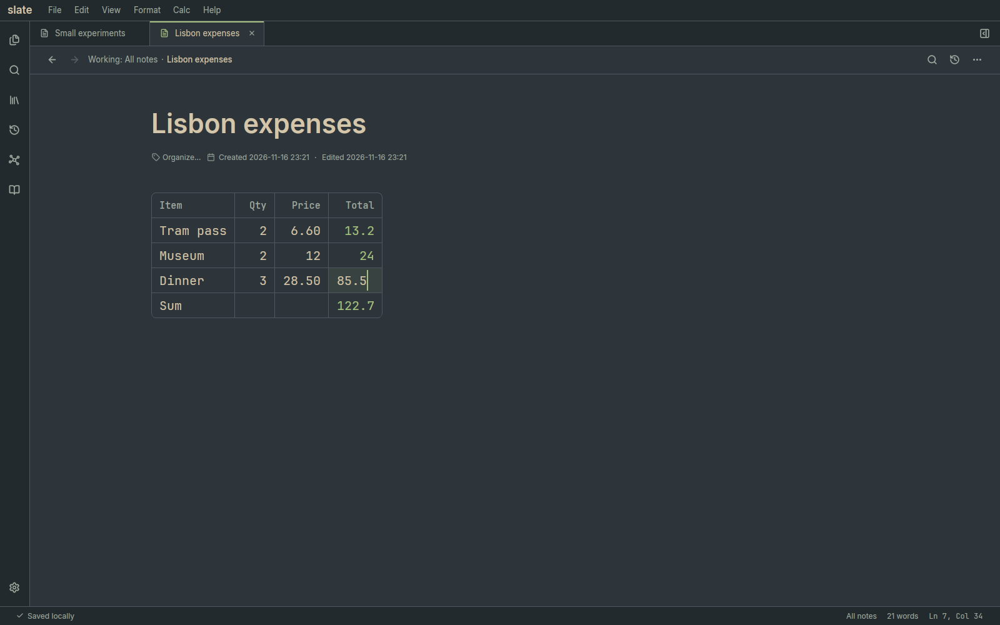
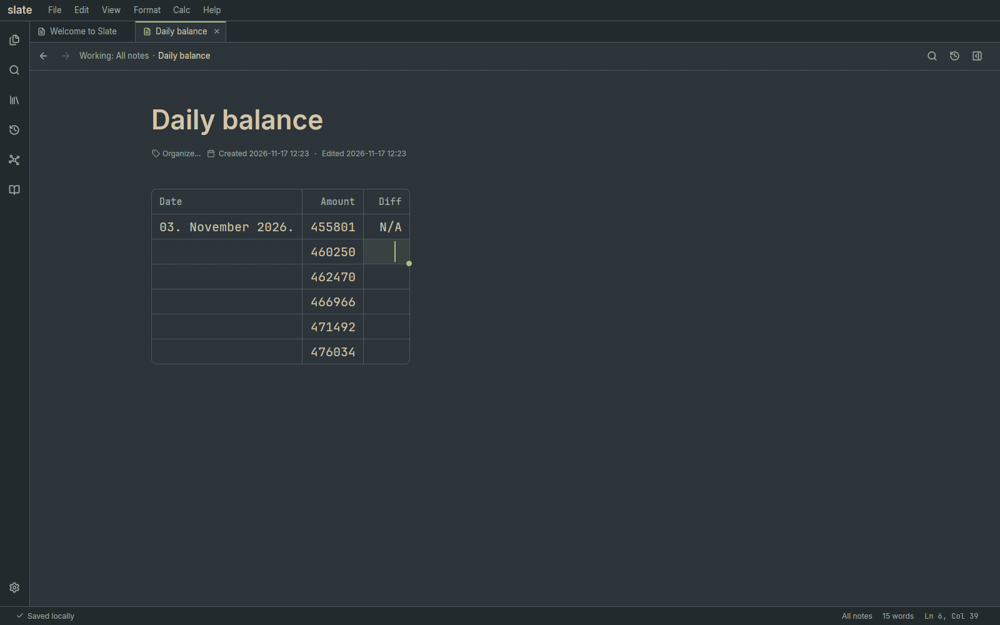
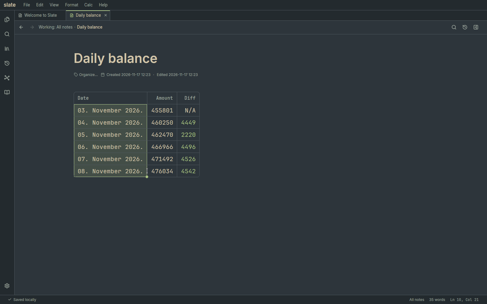

# Tables

Tables are ordinary Markdown tables that keep themselves tidy: columns line
up as you type, numbers align right when the column says so, and cells can
hold formulas like a small spreadsheet.

=== "Recording"

    

=== "Screenshot"

    [](media/tables.png)

## Making a table

- **Desktop:** `Ctrl+Shift+T` (or **Insert table** in the right-click menu)
  inserts an empty table. Typing `|` in the desktop app writes a literal `|`, so tables are
  made this way rather than by typing pipes.
- **Terminal:** type the header row with pipes (`| Item | Qty |`); `|`
  starts a row or adds a column.
- **Paste from a spreadsheet:** copy cells from a spreadsheet (tab-separated)
  or CSV text and paste outside a table; Slate turns them into a table whose
  first row is the header (on an empty line, or below the cursor's line).
- Or paste or type Markdown table text: `| --- |` under the first row makes
  it the header, and `---:` aligns a column to the right.

## Moving around

| Key | Does |
| --- | --- |
| `Tab` / `Shift+Tab` | Next / previous cell; `Tab` in the last cell adds a row |
| `Ctrl+Left` / `Ctrl+Right` | Previous / next cell |
| `Up` / `Down` | Same column, row above / below |
| `Enter` (desktop) | Same cell one row down, adding a row after the last |
| `Ctrl+Enter` (desktop) | New empty row below; on the last row, leave the table |
| `Shift+Enter` | A line break inside the cell |

`Shift`+arrows select a rectangle of whole cells in both apps: copying gives
tab-separated text (`Ctrl+C`, or `y` in the terminal's Normal mode),
`Delete` clears them, and `Ctrl+D` / `Ctrl+R` fill them (see
[Filling cells](#filling-cells)). On the desktop you can also click a cell to
edit it, and hovering a table's right or bottom edge shows a `+` strip that
adds a column or a row. Wide tables scroll sideways instead of wrapping. In
vim mode, `ci|`, `di|` and `yi|` change, delete and copy a cell.

## Formulas

A cell that starts with `:=` is a formula. The table shows its value; the
formula appears only while the cursor is in the cell.

| Formula | Means |
| --- | --- |
| `:=(1,2) * (1,3)` | Data row 1, column 2 times data row 1, column 3 |
| `:=(.,2) * (.,3)` | Columns 2 and 3 of the formula's own row |
| `:=(.-1,.) + (.,4)` | The cell above plus column 4 of this row: a running total |
| `:=(.,2) * ($1,$4)` | `$` pins a number, so filling never moves it |
| `:=sum_col()`, `:=avg_col()` | Sum / average of the other numbers in this column |
| `:=sum_row()`, `:=avg_row()` | Sum / average of the other numbers in this row |
| `:=tax_rate * (2,4)` | Note variables work in formulas too |

References are `(row, column)`, counting data rows from 1 (the header is not
a row). A `.` stands for the formula's own row or column, optionally with an
offset such as `.-1`. Typing `sum` or `avg_` in a formula cell offers the helpers. Errors
show in the cell: `!ERROR#out_of_bounds`, `!ERROR#non_numeric`,
`!ERROR#self_reference` and `!ERROR#cycle`.

Here is the table from the recording as it is stored:

```markdown
| Item      | Qty | Price |         Total |
| --------- | --: | ----: | ------------: |
| Tram pass |   2 |  6.60 | :=(1,2)*(1,3) |
| Museum    |   2 |    12 | :=(2,2)*(2,3) |
| Dinner    |   3 | 28.50 | :=(3,2)*(3,3) |
| Sum       |     |       |   :=sum_col() |
```

To total some rows by hand, select them and run `:sum` or `:avg`.

## Filling cells

Write a formula or a date once and fill it into the cells next to it, as in
a spreadsheet.

=== "Recording"

    

=== "Screenshot"

    [](media/table-fill.png)

- **Drag the handle (desktop):** the focused cell shows a dot where its
  right and bottom borders meet. Drag it down or up the column, or along the
  row, and release. Dragging past the top or bottom of the window scrolls the
  note; the fill stops at the table's first and last rows, never the header.
  `Esc` while dragging cancels.
- **Keys (both apps):** select cells with `Shift`+arrows, starting at the cell
  to copy, and press `Ctrl+D` to fill down or `Ctrl+R` to fill right.

A fill is one undo step. What each copy gets:

| In the source cell | Each filled cell gets |
| --- | --- |
| `:=(2,2)-(1,2)` | References moved by the copy's distance: one row down reads `:=(3,2)-(2,2)` |
| `:=(.,2) * (.,3)` | The same text: `.` already means "this row" |
| `:=(.,2) * ($1,$4)` | `$1,$4` kept, so every row reads the same rate cell |
| `03. November 2026.` | The next day, in the same format: `04. November 2026.` |
| `455801`, `N/A` | A plain copy |

Dates are recognised as `2026-11-03`, `3.11.2026.`, `03. 11. 2026`,
`03. November 2026.`, `3 Nov 2026` and `November 3, 2026`, and keep their
dots, zero padding and month spelling. Slash dates such as `11/03/2026` are
copied as they are, since the day and month order is ambiguous. A reference
moved above the first row reads `!ERROR#out_of_bounds`.
