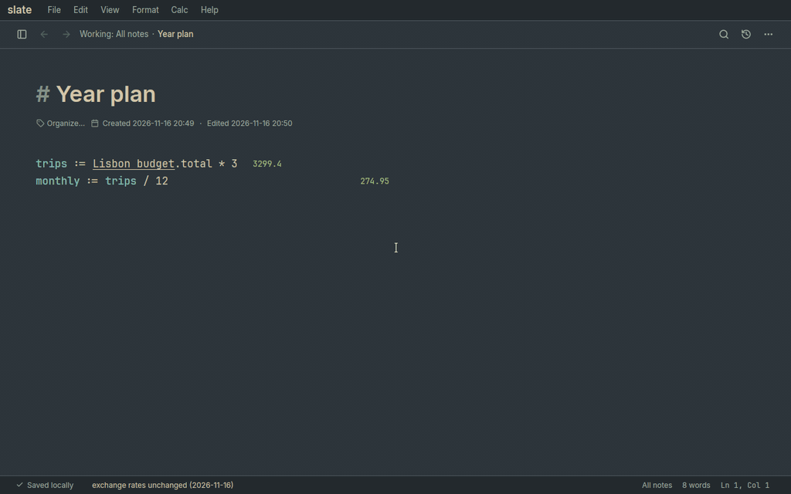

# Tables

Tables are ordinary Markdown tables that keep themselves tidy: columns line
up as you type, numbers align right when the column says so, and cells can
hold formulas like a small spreadsheet.



## Making a table

- **Desktop:** `Ctrl+Shift+T` (or **Insert table** in the right-click menu)
  inserts an empty table. Typing `|` in the desktop app writes a literal `|`, so tables are
  made this way rather than by typing pipes.
- **Terminal:** type the header row with pipes (`| Item | Qty |`); `|`
  starts a row or adds a column.
- **Paste from a spreadsheet:** copy cells from a spreadsheet (tab-separated)
  or CSV text and paste on an empty line; Slate turns them into a table.
- Or paste or type Markdown table text: `| --- |` under the first row makes
  it the header, and `---:` aligns a column to the right.

## Moving around

| Key | Does |
| --- | --- |
| `Tab` / `Shift+Tab` | Next / previous cell; `Tab` in the last cell adds a row |
| `Ctrl+Left` / `Ctrl+Right` | Previous / next cell |
| `Up` / `Down` | Same column, row above / below |
| `Enter` (desktop) | Same cell one row down, adding a row after the last |
| `Ctrl+Enter` (desktop) | New empty row below; on the last row, leave the table |
| `Shift+Enter` | A line break inside the cell |

On the desktop you can also click a cell to edit it, `Shift`+arrows select a
rectangle of cells (copy gives tab-separated text, `Delete` clears them), and
hovering a table's right or bottom edge shows a `+` strip that adds a column
or a row. Wide tables scroll sideways instead of wrapping. In vim mode,
`ci|`, `di|` and `yi|` change, delete and copy a cell.

## Formulas

A cell that starts with `:=` is a formula. The table shows its value; the
formula appears only while the cursor is in the cell.

| Formula | Means |
| --- | --- |
| `:=(1,2) * (1,3)` | Data row 1, column 2 times data row 1, column 3 |
| `:=sum_col()`, `:=avg_col()` | Sum / average of the other numbers in this column |
| `:=sum_row()`, `:=avg_row()` | Sum / average of the other numbers in this row |
| `:=tax_rate * (2,4)` | Note variables work in formulas too |

References are `(row, column)`, counting data rows from 1 (the header is not
a row). Typing `sum` or `avg_` in a formula cell offers the helpers. Errors
show in the cell: `!ERROR#out_of_bounds`, `!ERROR#non_numeric`,
`!ERROR#self_reference` and `!ERROR#cycle`.

Here is the table from the recording as it is stored:

```markdown
| Item      | Qty | Price |         Total |
| --------- | --: | ----: | ------------: |
| Tram pass |   2 |  6.60 | :=(1,2)*(1,3) |
| Museum    |   2 |    12 | :=(2,2)*(2,3) |
| Dinner    |   3 | 28.50 | :=(3,2)*(3,3) |
| Sum       |     |       |   :=sum_col() |
```

To total some rows by hand, select them and run `:sum` or `:avg`.
