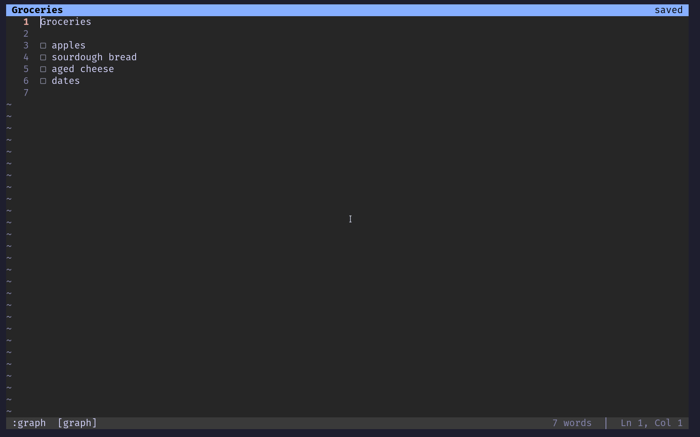
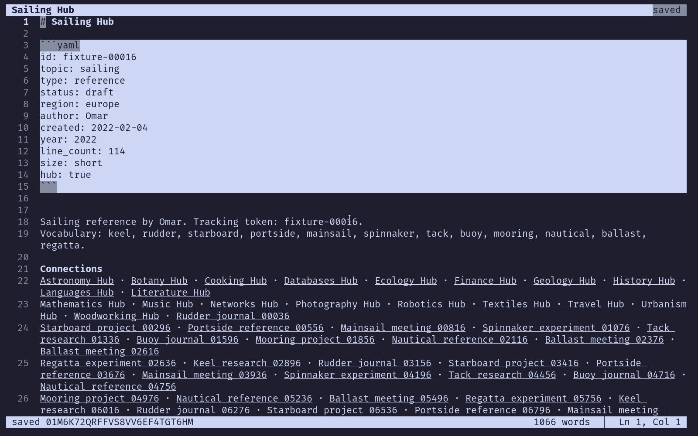

# The terminal app

`slate` is the whole of Slate in a terminal: the same notes, the same editor,
calculations, tables, links, search, browser, history, graph, encryption and
AI features, driven entirely from the keyboard. It is a single small binary,
starts instantly, and works over SSH.

=== "Recording"

    

=== "Screenshot"

    [](media/tui-tour.png)

## Getting around

| Key | Does |
| --- | --- |
| `Ctrl+P` | Note switcher (the same [search language](search.md)) |
| `Ctrl+B`, or `-` in Normal mode | Browser: collections, notes and a preview, like the yazi file manager |
| `Ctrl+G` | Choose the working collection |
| `Ctrl+E`, or `:` in Normal mode | Command bar, with word completion (`Tab` picks, `Up` recalls history) |
| `F1`, or `?` in Normal mode | Help |
| `F4` | Note info |
| `Ctrl+Q` | Quit |

The app starts in Insert mode, so you can type straight away; `Esc` switches
to vim's Normal mode (see [Vim mode](vim-and-scripts.md)). The status bar
shows hints for the main keys (`[editor] status_hints = false` hides them),
and while text is selected it shows the sum, average and count of the
numbers in it.

## What differs from the desktop app

- **Diagrams** show their source text. `:diagram` inserts an empty diagram
  block; draw it in the desktop app.
- **Images** show as `[image: …]`. `gx` previews one inside the terminal
  with sixel, kitty or iTerm2 graphics when your terminal supports them
  (`[terminal] images`), with a block-character fallback; `o` opens it in
  your image viewer.
- **The graph** is drawn with characters; `]`/`[` zoom and
  `Shift+H`/`J`/`K`/`L` pan.
- **Tables** are edited as text, with cell-aware keys.
- **Fonts** come from your terminal's settings. Icons use a
  [Nerd Font](https://www.nerdfonts.com/) by default; set
  `[theme] icons = "unicode"` or `"ascii"` otherwise.

## Colours and clipboard

Slate detects whether your terminal supports true colour, 256 colours or
16, including over SSH and inside tmux, and honors `NO_COLOR`. Copies go to
the system clipboard through `wl-copy`, `xclip`, `xsel`, `pbcopy`, tmux or
the terminal itself (OSC 52). Set `[terminal] clipboard = "osc52"` to always
copy through the terminal, which works over SSH.

## From the shell

```sh
slate                      # open the last note
slate --new                # start a new note
slate notes/plan.md        # edit a Markdown file in place
slate today                # today's daily note
slate capture buy milk     # add a line to today's note without opening Slate
cmd | slate append         # append output to the last edited note
slate --list               # list notes
slate imap-sync            # pull new email once
slate mcp                  # serve notes to AI assistants
slate run <script>         # run one of your scripts on stdin
```

See [Organizing](organizing.md#daily-notes-and-quick-capture) for
capture and append, and [AI](ai.md) for `slate mcp`.
