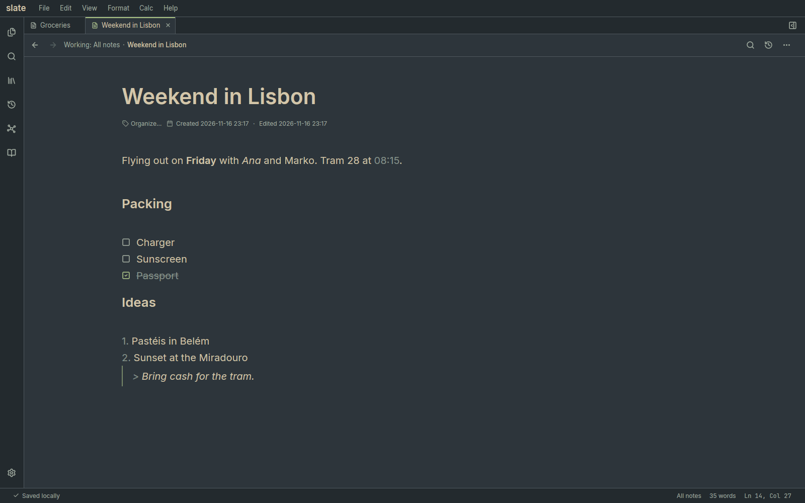

# Themes and configuration

## Themes



**Desktop:** **View › Theme** switches instantly and is remembered. It offers
Everforest Dark (the default) and Light, neutral Default Dark and Light, the
14 color schemes below, and *From config*, which follows the `[theme]`
section of the config file like the terminal app does.

**Terminal:** set the scheme in the config file; changes apply live, without
a restart:

```toml
[theme]
color_scheme = "catppuccin-mocha"
accent = "auto"        # or amber, sage, rose, plum, cobalt, slate, or "#4f7bd9"
icons = "nerd"         # "unicode" or "ascii" if your font has no Nerd Font icons
```

The color schemes: `slate-light`, `slate-dark`, `catppuccin-mocha`,
`catppuccin-latte`, `gruvbox-dark`, `gruvbox-light` (the terminal default),
`dracula`, `dark`, `white`, `solarized-dark`, `solarized-light`, `nord`,
`tokyo-night` and `one-dark`.

**Your own colours.** `[theme.colors]` overrides single colours with hex
values. `background = "none"` lets the terminal's own background (and its
transparency) show through:

```toml
[theme.colors]
background = "none"
accent = "88c0d0"
code-block-background = "3b4252"
variable = "ebcb8b"
```

Keys: `foreground`, `background`, `accent`, `code-block-background`,
`selection-background`, `keyword`, `string`, `number`, `comment`,
`function`, `type`, `variable`, `search-match`, `search-current`.

## Desktop look and feel

| Setting | Where |
| --- | --- |
| Font and size | `[theme] font = "JetBrains Mono"`, `font_size = 16`, `fallback = [...]` |
| Note text size | `Ctrl+=`, `Ctrl+-`, `Ctrl+0` resets (**View › Zoom in/out**, remembered) |
| Interface text size | **View › Interface text** (85% to 150%) |
| Proportional prose | **View › Proportional prose**: text in a sans face, code and tables stay monospace |
| Line wrapping | **View › Wrap lines** (`Alt+Z`) |
| Line numbers | **View › Line numbers**, or `[editor] line_numbers` |
| Sidebar | `Ctrl+\` |
| Distraction-free preview | `F11` (`Esc` leaves) |
| Animations | `[gui] animations = false`, or `[gui.dialog_animation] style = "none"`, `"fade"`, `"slide"`, `"fade-slide"` or `"bounce"` |

The window reopens at the size and place it closed with.

## The config file

`~/.config/slate/config.toml` (or `$XDG_CONFIG_HOME/slate/config.toml`) is
created on first run with every setting and a comment for each. Both apps
read it. The settings people change most:

```toml
[editor]
autosave = true                  # save after a short pause
vim_mode = false                 # start in vim Normal mode
wrap = true                      # soft-wrap long lines (tables and code scroll instead)
checklist_auto_reorder = true    # ticked items sink to the bottom
format_on_save = false           # tidy Markdown before each save
date_format = "%Y-%m-%d"
date_time_format = "%Y-%m-%d %H:%M"
variable_autocomplete_min_chars = 3
command_popup = true             # desktop: suggestions above the command bar

[editor.modules]                 # calculation features for new notes
math = true
table = true
variables = true
style = true
cross_note = true

[startup]
default_collection = ""          # start in this collection

[daily]
template = "# {date}\n\n"

[search]
beautiful = true                 # pills and dimmed field names in search boxes

[terminal]
images = "auto"                  # sixel, kitty, iterm2, halfblocks or off
clipboard = "auto"               # "osc52" keeps copies in the terminal (works over SSH)
```

Other sections are covered on their own pages: `[currency]`
([calculations](calculations.md#currencies)), `[imap]`
([email](export-backup-email.md#email-into-notes-imap)), `[agent]` and
`[mcp]` ([AI](ai.md)), `[editor.security]`
([encryption](encryption.md)), `[scripts]` and `[keybindings]`
([scripts](vim-and-scripts.md)), `[web_search]`
([lookup](search.md#web-lookup)).

Every setting is described in the [configuration reference](reference/configuration.md).
