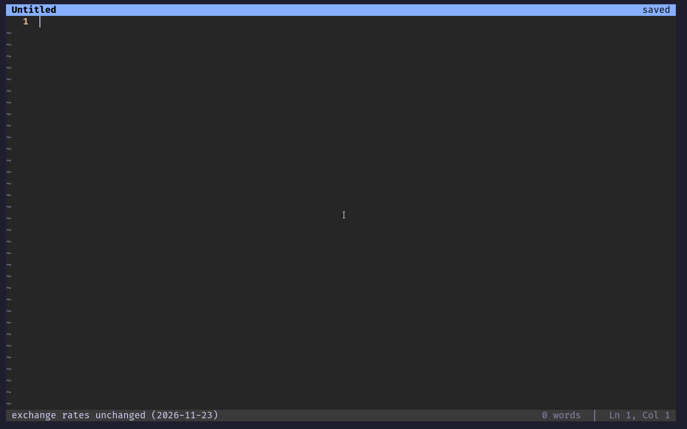

# Vim mode, macros and scripts

This page is for people who like to keep their hands on the keyboard. If you
know Vim you already know most of it; if you don't, you can skip it and
never miss anything.

## Turning vim mode on

- **Terminal:** the app is always modal. It starts in Insert mode so you can
  type; `Esc` goes to Normal mode. `[editor] vim_mode = true` starts in
  Normal mode.
- **Desktop:** **View › Editing mode › Vim**. The status bar shows the mode
  in color: accent for Normal, blue for Insert, purple for Visual.

The vim engine is shared by both apps, so the keys behave the same in each.



## Moving and editing

| Keys | Does |
| --- | --- |
| `h` `j` `k` `l`, `w` `b` `e`, `0` `^` `$` | Move by character, word, line |
| `gg`, `G`, `12G` | First line, last line, line 12 |
| `f,` `t)` `F(` `T"`, then `;` `,` | Jump to a character on the line, and repeat |
| `%` | Matching bracket |
| `gj` / `gk` | Down / up one screen row on wrapped lines |
| `i` `a` `I` `A` `o` `O` | Insert before, after, at line start, at line end, new line below, above |
| `x`, `r{c}`, `s`, `S`, `D`, `C`, `J` | Delete, replace, substitute, delete or change to line end, join |
| `dd`, `yy`, `cc`, `3dd` | Delete, copy, change lines |
| `d` `c` `y` + any motion | `dw`, `c$`, `y%`, `df,`, `ct)` … |
| `p` / `P` | Paste after / before (from the system clipboard when the register is empty) |
| `u` / `Ctrl+R` | Undo / redo |
| `.` | Repeat the last change, including what you typed |
| `v`, `V` | Visual and visual-line selection; then `d` `y` `c`, or `:` for a command on the selection |

**Text objects** work with `d`, `c` and `y`: `iw`/`aw` (word),
`i(` `i[` `i{` `i"` `` i` `` `i*` `i~` `i_` and their `a` forms (inside or
around delimiters, including Markdown emphasis), and `i|`/`a|` for a table
cell.

**Slate extras in Normal mode:**

| Keys | Does |
| --- | --- |
| `gd` | Follow a link, or jump to a variable's definition |
| `K` | Preview the linked note |
| `gx` | Preview the image at the cursor |
| `gX` | Open the image at the cursor in your image viewer |
| ``di` `` / ``ci` `` | In a fenced block such as a diagram: clear its body (``ci` `` leaves an empty line to type in); ``da` `` removes the whole block |
| `za` | Fold or unfold |
| `-` | Open the browser |
| `/`, then `n` / `N` | Search the note |
| `?` | All keys, with how each works |

After a prefix like `d`, `c`, `g` or `ci`, the status bar lists the keys that
can follow and what each does, so you never have to remember them all.

## Macros

Record a sequence of keys once and replay it:

| Keys | Does |
| --- | --- |
| `qa` | Start recording into register `a` (any of `a`–`z`, `0`–`9`) |
| `q` | Stop |
| `@a` | Replay it |
| `5@a` | Replay it five times |

In the recording above, `qa I- [ ] <Esc> j q` turns one line into a checklist
item, and `3@a` does the next three.

## Your own key bindings

Bind keys to any Slate command in `~/.config/slate/config.toml`:

```toml
[keybindings.normal]
"<Space>t" = "today"
"<Space>g" = "graph"
"<Space>e" = "export pdf /tmp/note.pdf"

[keybindings.editor]          # Insert mode, or the desktop's Standard mode
"<C-t>" = "date"

[keybindings.visual]
"<C-b>" = "bold"
```

Keys are written like `<C-x>` (Ctrl), `<Space>`, `<Esc>`, `<Enter>`,
`<Tab>`, arrows and plain characters; a binding is up to 8 keys. Restart
Slate after changing them.

## Scripts

Hook your own programs into Slate: a script gets the selection, the note or
nothing on stdin, and its output replaces the selection, is inserted, or is
shown as a message.

```toml
[scripts.uppercase]
argv = ["python3", "/home/you/slate-scripts/uppercase.py"]
input = "selection"            # "none", "selection" or "note"
output = "replace-selection"   # "insert", "replace-selection" or "message"

[keybindings.visual]
"<C-u>" = "run uppercase"
```

Run one with `:run uppercase` (arguments follow the name). Ready-made
examples are in [`scripts/examples`](https://github.com/dborovcanin/slate-docs/blob/main/examples/scripts/README.md); the
full protocol is in [Scripts and shortcuts](reference/scripting.md). Scripts also run
from the shell: `echo hello | slate run uppercase`.
