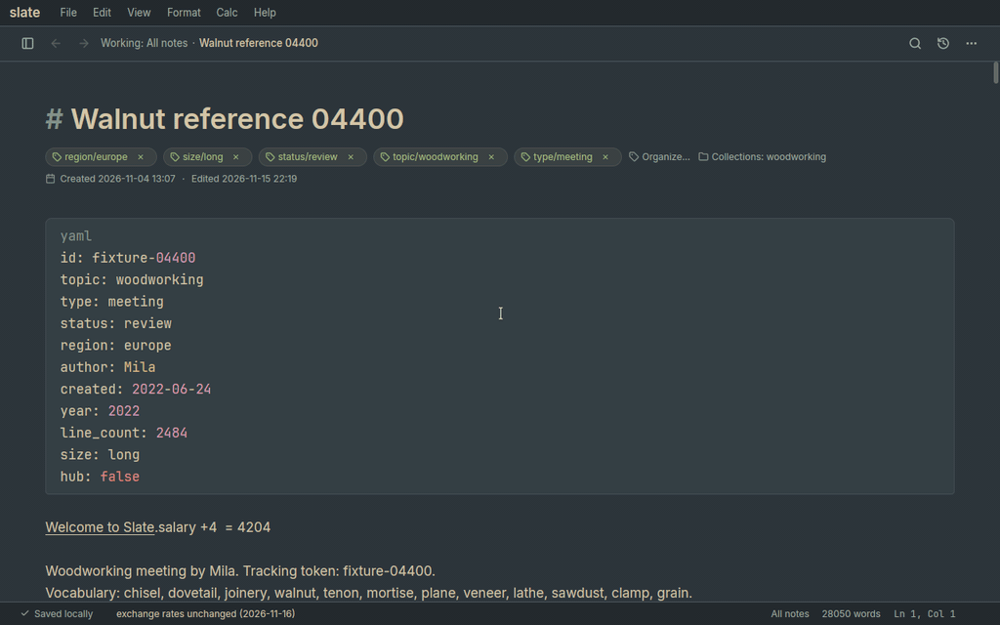

# Writing

Slate notes are plain Markdown. There is no separate preview: headings,
emphasis, lists and the rest are styled right where you type them, and the
raw Markdown shows again on the line you are editing.



## Markdown as you type

| You type | You get |
| --- | --- |
| `# Title`, `## Section`, `### …` | Headings (levels 1–6) |
| `**bold**`, `*italic*`, `~~strike~~`, `` `code` `` | Inline styles |
| `- item`, `1. item` | Bullet and numbered lists |
| `- [ ] task` | A checklist item; `- [x]` is ticked |
| `> quote` | A quote, drawn with a rail beside it |
| ```` ``` ```` | A code block, drawn as one rounded surface |
| `---`, `***` or `___` alone on a line | A divider across the page |
| `[text](https://…)` | A link |
| `[[` | A link to another note (see [Links](links-and-graph.md)) |

**Lists continue themselves.** `Enter` on a list item starts the next one,
numbered lists count up, and `Enter` on an empty item ends the list. `Tab`
and `Shift+Tab` indent and outdent an item.

**Checklists.** Type ` /x` at the end of an item to tick it, or use
`:checklist toggle` (desktop Standard mode: `Ctrl+Enter`). With
`[editor] checklist_auto_reorder = true`, ticked items move below the open
ones, as in the recording above.

## Formatting from the keyboard

Select text, then run a format command, or on the desktop use the small
toolbar that appears over a selection.

| Command | Desktop shortcut (Standard mode) | Does |
| --- | --- | --- |
| `:bold`, `:italic`, `:strike`, `:icode` | `Ctrl+B`, `Ctrl+I`, `Ctrl+Shift+X` | Toggle an inline style |
| `:h1`, `:h2`, `:h3`, `:format text` | `Ctrl+Alt+1`/`2`/`3`, `Ctrl+Alt+0` | Headings, or back to plain text |
| `:ulist`, `:olist`, `:checklist` | `Ctrl+Shift+8`/`7`/`9` | Turn lines into a list |
| `:format clear` | | Remove inline styles |
| `:format` | | Tidy the whole note's Markdown |

`[editor] format_on_save = true` runs `:format` before every save.

The selection toolbar also shows the sum of the numbers you selected, and
the terminal status bar shows sum, average and count while text is selected.

## Undo and history

`Ctrl+Z` undoes and `Ctrl+Y` (or `Ctrl+Shift+Z`) redoes; in vim mode `u` and
`Ctrl+R` do the same. Undo puts the cursor back where the change happened.
Beyond undo, Slate keeps older versions of every note; see
[Note history](organizing.md#note-history).

## Folding and outline

- `:fold`, `:unfold`, `:fold-toggle` (vim: `za`, `zc`, `zo`) fold the
  section, list or block at the cursor. On the desktop, click the arrow beside
  a line number. A folded block shows how many lines it hides.
- `:toc` opens a heading picker for the note: type to filter, `Enter` jumps.
- `:toc insert` writes a table of contents into the note; `:toc refresh`
  updates it after you change headings.

## Images

`` shows the image. On the desktop a line with
only an image is drawn as the picture. In the terminal it shows as
`[image: alt text]`; `gx` previews it in the terminal (sixel, kitty or iTerm2
graphics, with a fallback), and `o` in the preview opens it in your image
viewer.

To add one, paste an image file path, or paste a screenshot from the
clipboard: `Ctrl+V` on the desktop, `p` or `:paste-image` in the terminal. The
image is copied into the note's assets. Remote images are never fetched.

## Dates and reminders

- `:date` opens a date picker and inserts the date. Type `tomorrow`,
  `next friday 10 pm` or `in 3 weeks`, or pick it on the calendar.
- `:remind` sets a reminder on the current line. It shows beside the line
  and pops up a desktop notification when it is due. `:remind toggle`
  removes it.
- Dates use `[editor] date_format` and `date_time_format` from the config.

## Clipboard

Yanks and copies go to the system clipboard. `:clip-watch on` pastes
everything you copy elsewhere into the note, one entry after another, until
`:clip-watch off`. Handy for collecting quotes or links while browsing.

## Changes made elsewhere

If the open note changes outside Slate (in the other app, through an AI
assistant, or from `slate capture`), Slate loads the new text within a second
as one step you can undo. If you have unsaved edits it keeps yours and tells
you: `:w!` keeps your version, `:e!` loads the other one.
